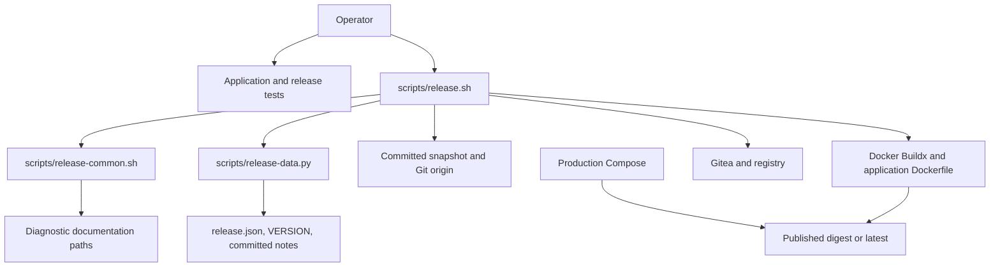

# Brooks-Lint Health Dashboard

- [Brooks-Lint Health Dashboard](#brooks-lint-health-dashboard)
  - [Dimension Scores](#dimension-scores)
  - [Module Dependency Graph](#module-dependency-graph)
  - [Test Suite Map](#test-suite-map)
  - [Top Findings](#top-findings)
    - [Warning](#warning)
  - [Recommendation](#recommendation)

**Mode:** Health Dashboard

**Scope:** Plan review of `tasks/01-update-build-image/2-plan.md`, checked against current image/deployment configuration and reference commit `5b918ba0aefb9ac9643fa99976140c95d17cb3e2`. Scores describe the proposed plan, not implemented code or whole-project health. No `.brooks-lint.yaml` exists; balanced defaults apply.

**Composite Score:** 98/100

**Trend:** Previous Health Dashboard score 98; numerically unchanged, but the prior branch review has a different scope and is not a comparable quality trend.

Revise the documentation dependency list and test-adoption instructions before implementation. No critical findings; live publication still requires the plan's existing readiness gates.

## Dimension Scores

- Code Quality: 100/100. The planned change set separates application checks from release orchestration and preserves unrelated work; no additional R1/R2 finding.
- Architecture: 95/100. One R5 warning: copied command diagnostics depend on documentation missing from the adoption list.
- Tech Debt: 100/100. Immutable provenance, explicit migration boundaries, synchronized version metadata, and preservation of historical release evidence address the observed maintenance risks. The acknowledged upstream warnings remain release gates, not new findings here.
- Test Quality: 95/100. One T1 warning: upstream tests contain repository-layout and README assumptions that the plan does not resolve.

Balanced deductions: each warning subtracts 5 from its assigned dimension. Composite: `100 × 0.25 + 95 × 0.30 + 100 × 0.25 + 95 × 0.20 = 97.5`, rounded half-up to 98. Two warnings are counted once each; no critical or suggestion findings.

## Module Dependency Graph

Proposed workflow and its operational dependencies; not an application-wide import graph.

## Test Suite Map

- Existing application suite: 39 `src/**/*.test.ts` / `src/**/*.test.tsx` files, mixing unit and component/route tests. Exact unit/integration test-case counts were not measured.
- Existing browser suite: five `e2e/*.spec.ts` files; Playwright config runs desktop and mobile projects against a disposable database.
- Planned release suite: upstream `tests/test_bash_release.py`, `tests/fixtures/bash_release_ports.py`, and package marker `tests/__init__.py`. Publication tests use temporary Git repositories and fake Git/curl/Docker ports, not production services.
- Planned consumer coverage: version/configuration agreement, OCI metadata, image input allowlist, deployment image selection, and token-interface migration.
- No tests were executed: this is a design review. Runtime architecture compatibility and publication safety are not established by these file counts or fake-port tests.

## Top Findings

### Warning

**1. R5 — Copied diagnostics depend on documentation outside the adoption list**

Symptom: `2-plan.md:23-26` copies the release scripts unchanged, while `2-plan.md:44-49` mainly rewrites `docs/publish-a-release.md`. At the pinned reference, `scripts/release-common.sh` directs failures to `docs/bash-configuration.md`, `docs/release-process.md#troubleshooting`, and `docs/platform-preparation.md`. Those files do not appear in the plan's copy list and are absent from this project's current release documentation.

Source: *Clean Architecture* — dependency management and cohesive boundaries; *A Philosophy of Software Design* — Information Hiding and Leakage.

Consequence: Operators following the release command's own failure guidance reach missing files during credential, builder, source, or uncertain-publication failures. The adopted runtime interface and its recovery instructions become inconsistent despite successful script tests.

Remedy: Add an explicit documentation dependency inventory at the pinned commit. Copy and adapt the required dedicated documents, including their transitive links, or deliberately update every diagnostic reference to supported local guidance. Record any script adaptation in provenance and test the emitted local documentation paths and anchors. Keep recovery semantics unchanged.

**2. T1 — Upstream test layout and consumer assertions are not specified**

Symptom: `2-plan.md:24` proposes copying fixtures/tests into an unspecified dedicated directory. The pinned `tests/test_bash_release.py` sets `ROOT = Path(__file__).resolve().parents[1]` and loads `ROOT / "tests/fixtures/bash_release_ports.py"`. Its `test_root_version_drives_settings_readme_and_notes` also requires `Version <version>` and a versioned release-notes link in root README. Current README has neither, and the plan intentionally keeps README edits minimal. `2-plan.md:53-55` requires the copied suite to pass without resolving these concrete assumptions or naming its command.

Source: *xUnit Test Patterns* — Mystery Guest and fixture clarity; *The Art of Unit Testing* — test isolation and explicit dependencies.

Consequence: Straight copying into a nested test directory can target the wrong project root or fail fixture discovery. Copying into root `tests/` still fails template-specific README checks. The implementer must invent a test layout or weaken assertions to obtain a green suite, obscuring whether consumer behavior is protected.

Remedy: Name the exact destination files and command, for example root `tests/test_bash_release.py`, `tests/fixtures/bash_release_ports.py`, `tests/__init__.py`, and `python3 -B -m unittest discover -s tests -v`. Explicitly adapt template-only README assertions to the chosen consumer documentation contract while retaining version/notes checks and all publication failure/retry regressions. Keep copied test adaptations separate from protocol-script changes and add consumer-specific assertions rather than deleting relevant safety coverage.

## Recommendation

Update the plan with the complete documentation dependency list and a concrete test transplant contract. Preserve its existing safeguards: no template Hello World image, no secret logging, no automatic source push, no destructive recovery, and no publication from an implementation branch. The reference's N1/N2 warnings must still receive the separately reviewed readiness decision already required by step 6; this review does not approve live publication. Implementation code and `2-plan.md` remain unchanged.
