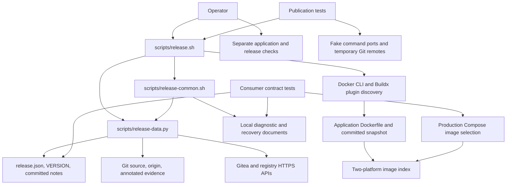

# Brooks-Lint Health Dashboard

- [Brooks-Lint Health Dashboard](#brooks-lint-health-dashboard)
  - [Dimension Scores](#dimension-scores)
  - [Module Dependency Graph](#module-dependency-graph)
  - [Test Suite Map](#test-suite-map)
  - [Top Findings](#top-findings)
    - [Warning](#warning)
  - [Verification and Limits](#verification-and-limits)
  - [Recommendation](#recommendation)

**Mode:** Health Dashboard

**Scope:** All 26 committed files on `01-update-build-image`, comparing `main...4ababac` against merge base `d3c2c5ac5778887f00f079aef395eb026d5b898b`. The base is local `main`; `origin/main` is four planning commits behind it. Reviewed release scripts, configuration, application-image integration, deployment selection, metadata, documentation, implementation evidence, and all added tests. No `.brooks-lint.yaml` exists; balanced defaults apply. Uncommitted `next-env.d.ts` and untracked `AGENTS.md` are excluded and preserved.

**Composite Score:** 95/100

**Trend:** The previous Health Dashboard score was 98 for the task plan. Its scope differs, so the numerical decrease of 3 is not a comparable code-quality trend.

The branch adopts the planned workflow faithfully, but publication remains blocked: both acknowledged upstream warnings reproduce, image verification is incomplete, and the transplanted tests retain two isolation problems. This review does not approve live publication.

## Dimension Scores

- Code Quality: 100/100, weight 0.25. No additional R1/R2 finding. The Bash sequence is linear and named; Python contains bounded I/O and strict evidence checks. Its size alone does not establish cognitive overload.
- Architecture: 95/100, weight 0.30. One R5 warning: replacing Docker authentication configuration can replace the selected Buildx executable after preflight.
- Tech Debt: 95/100, weight 0.25. One R6 warning: the publication lifecycle does not tighten the accepted alias state after confirmed promotion.
- Test Quality: 90/100, weight 0.20. One T2 warning for timeout cleanup and one T1 warning for an undeclared temporary-directory prerequisite.

Balanced scoring subtracts 5 per warning from its assigned dimension. Composite: `100 × 0.25 + 95 × 0.30 + 95 × 0.25 + 90 × 0.20 = 95.25`, rounded half-up to 95. Four warnings, no critical findings, and no suggestions are counted once each. The documented upstream warnings remain relevant in a code review even though preserving their pinned implementation was intentional; they are not deviations from the adoption plan.

## Module Dependency Graph

This graph covers changed release/deployment boundaries, not the application's unchanged internal module graph. No internal import cycle or application-to-release dependency was found.

## Test Suite Map

- Added Python suite: 125 discovered cases. Five interface tests, 29 data/helper tests, 83 subprocess publication scenarios, and eight consumer contract tests. Subtests increase scenario coverage without increasing these unittest counts.
- The 83 publication cases run the actual entry point against disposable Git repositories and fake Git/curl/Docker commands. They are local integration tests, not live registry, native Buildx, or application-image runtime tests. Twelve association scenarios also run with the separate Gitea 28.2.0 fixture contract.
- The 42 interface/helper/consumer cases combine strict parser and transport-boundary tests with local file, subprocess, and documentation checks; they are not all pure unit tests. Fakes are justified here because uncertain remote writes are themselves the behavior under test.
- Existing application context, unchanged by this branch: 39 Vitest files and 253 passing cases in the recorded implementation run. Unit, component, and route cases were not individually reclassified during this review.
- Existing browser context: five Playwright spec files and 30 configured desktop/mobile cases in the implementation run. They previously failed before browser execution. Chromium has since been installed and its headless launch verified, but those browser scenarios have not been rerun against a disposable database.
- Recorded full Python discovery passed all 125 cases in 817.719 seconds. This lengthy subprocess safety suite is a feedback-cost concern, but its protocol coverage is deliberate; runtime alone is not scored as an additional architecture defect. Earlier full-run failures and their successful retries remain recorded rather than erased.

## Top Findings

### Warning

**1. R6 — Confirmed promotion does not retire the predecessor from the allowed lifecycle states (Tech Debt; inherited N1)**

Symptom: `scripts/release-common.sh:71-85` permits either the captured predecessor or prepared digest on every `fresh_guard` call. `scripts/release.sh:151` confirms promotion to the prepared digest, but `scripts/release.sh:153-155` invokes that unchanged guard before release creation. In an isolated review fixture, the first post-promotion read confirmed the prepared digest; the next read restored the captured predecessor. The command still sent one release POST and created one release while `latest` pointed to the predecessor, then exited 1 during final verification. No successful publication was reported. This reproduces the warning already documented at `docs/bash-publication.md:67`.

Source: *Domain-Driven Design* — invariant ownership and lifecycle modeling; *Code Complete* — defensive programming and explicit error paths.

Consequence: An observed regression to the old alias is accepted before another remote write instead of stopping immediately. Final verification detects the inconsistency only after release creation. Writer exclusion remains required; this finding does not imply an atomic guard against arbitrary concurrent changes or authorize rollback.

Remedy: Keep the existing publication gate closed. Through an explicitly reviewed upstream pin or separately reviewed adaptation, distinguish pre-promotion alias acceptance from post-confirmation verification and require only the prepared digest before release POST. Add a regression that restores the predecessor after confirmed promotion and asserts no subsequent release or association write. Preserve accepted remote objects and historical script identities.

**2. R5 — Authentication isolation can change the Buildx executable after readiness checks (Architecture; inherited N2)**

Symptom: `scripts/release.sh:53-55` inspects Buildx using the original Docker configuration. `scripts/release.sh:67-72` preserves Buildx state through `BUILDX_CONFIG` but replaces `DOCKER_CONFIG`. `scripts/release-data.py:302-307` copies context metadata into the private configuration, not configuration-local CLI plugins or their discovery settings. A daemon-free probe with a temporary `cli-plugins/docker-buildx` returned `review-config-local-buildx` before the switch and system Buildx `v0.38.1` afterward, despite the same `BUILDX_CONFIG`. Existing connection tests use a fake `docker` executable and therefore cannot exercise native plugin discovery.

Source: *Clean Architecture* — Stable Dependencies and infrastructure boundaries; *Software Engineering at Google* — dependency management and observable compatibility contracts.

Consequence: Readiness can validate one implementation while build or promotion uses another, or fails if no fallback plugin exists. Preserving the selected builder's state is not enough to preserve its CLI implementation. This remains relevant even with exclusive publication access and valid credentials.

Remedy: Resolve the inherited warning through an explicit reviewed pin or reviewed applicability decision before publication. Preserve or explicitly constrain the approved plugin implementation across the private-auth boundary without inheriting unrelated credentials or credential helpers. Verify this with a native Docker CLI discovery regression using configuration-local and system-plugin cases; do not treat fake connection-selection tests as equivalent evidence.

**3. T2 — A publication-test timeout leaves release descendants running (Test Quality)**

Symptom: `tests/test_bash_release.py:134-139` uses `subprocess.run(..., timeout=90)` without timeout-specific cleanup. The entry point execs the Python lock owner, which starts its Bash child in a new session at `scripts/release-data.py:668`. Python's `subprocess.run` timeout kills only its immediate process, not that child or independently grouped helper commands. A review-only probe reduced the outer timeout to one second without modifying tracked files; after `TimeoutExpired`, three fixture processes remained: the Bash release child, its inventory helper, and fake Git. Review-owned survivors were signaled before removing the disposable fixture. The special progress/signal tests have explicit cleanup, but ordinary `release()` calls do not.

Source: *xUnit Test Patterns* — Erratic Test and fixture teardown; *The Art of Unit Testing* — test isolation.

Consequence: A slow or failed case can keep executing against a fixture that unittest is removing, leak processes or locks, and consume resources during later cases. The previous full suite did encounter a 90-second timeout; the survivor mechanism is confirmed, but it has not been established as the cause of the other intermittent failures.

Remedy: Add ownership-aware subprocess teardown to the common publication-test harness. On timeout, forward termination through the lock owner while it is still alive, wait for cleanup, and escalate only against owned surviving processes as needed. A process-group kill alone is insufficient because the lock owner creates a separate child session. Add a harness regression proving descendants exit and owned temporary paths/locks are released. Do not merely increase the timeout or weaken safety assertions; record any test adaptation separately from protocol provenance.

**4. T1 — Tests silently require a pre-existing OpenCode-specific temporary directory (Test Quality)**

Symptom: `tests/test_consumer_release.py:134` and `tests/test_bash_release.py:1182` pass the literal `dir="/tmp/opencode"` to `tempfile.TemporaryDirectory`. Neither creates that parent or falls back when it is absent. By contrast, the publication fixture at `tests/test_bash_release.py:76` checks whether the directory exists. The documented verification prerequisites and `python3 -B -m unittest discover -s tests -v` command do not require this harness directory.

Source: *xUnit Test Patterns* — Mystery Guest; *The Art of Unit Testing* — test isolation and explicit environment dependencies.

Consequence: On an ordinary checkout or CI runner without `/tmp/opencode`, at least the consumer validation-isolation test and same-origin bearer test fail with `FileNotFoundError` before checking release behavior. The successful local suite masks this portability failure because this environment supplies the directory. This is a source-confirmed dependency; no shared directory was removed to reproduce it.

Remedy: Prefer `/tmp/opencode` when it exists, as the publication fixture already does, but otherwise use the platform temporary directory or an explicit supported test-root setting. Apply that policy consistently to consumer and adopted tests, and record the test adaptation without changing protocol scripts. Verify the suite both with and without the preferred directory available.

## Verification and Limits

- During this review, `bash -n scripts/release.sh scripts/release-common.sh`, `./scripts/release.sh --validate`, and `git diff main...HEAD --check` passed. Offline validation reported no credentials or remote operations.
- During this review, `python3 -B -m unittest tests.test_bash_release.BashInterfaceTests tests.test_bash_release.BashDataTests tests.test_consumer_release -v` passed all 42 cases in 1.165 seconds. Consumer hash checks still match the pinned protocol and fake-port fixture; version/notes/npm agreement, diagnostic links, image-selection contracts, and missing-token isolation passed.
- Reviewed the completed full-suite log: all 125 cases passed in 817.719 seconds. The full 13-minute publication suite was not rerun again for this review. Implementation logs and `4-implemented.md` retain the earlier failures and targeted retries.
- Independent probes used only disposable fixtures under `/tmp/opencode`: post-promotion predecessor restoration, native CLI plugin discovery with `docker buildx version` and no daemon operation, and forced test-timeout process inspection. No production service, registry, token, tag, or package was accessed or changed. Temporary command-port injection did not modify tracked tests or protocol scripts.
- Existing implementation evidence reports successful formatting, lint, type checking, Vitest, and production build. Those application checks were not rerun during this review. This review does not attribute the earlier native crashes to this branch or claim they were repaired.
- Application-image acceptance remains incomplete: no successful final AMD64/ARM64 image build or image startup, migration, health, persistence, or Chromium runtime evidence exists. The repeated image build failed during Chromium system-dependency installation; workspace Chromium installation does not repair the image builder or certify either image architecture. Browser E2E verification also remains outstanding after installation.
- Version `0.7.8` remains provisional for publication because the recorded unauthenticated package lookup returned HTTP 401. Local `main` is not already pushed to the configured origin, and unrelated workspace changes prevent a clean release checkout. No remote inventory, source push, live publication, privileged preparation, or destructive recovery was attempted in this review.
- The plan review's missing diagnostic-document and test-layout findings are resolved in the branch. Copied diagnostics and transitive local document targets resolve; root test discovery and the consumer documentation assertion work. Keeping npm metadata synchronized with authoritative `VERSION`, retaining legacy deployment tags, and pinning vendor hashes are intentional checked contracts, not ungoverned duplication.

## Recommendation

Keep live publication blocked. The adoption matches the reviewed plan and its explicit unresolved-warning policy, but this report is not the separately reviewed N1/N2 readiness waiver. Prioritize a focused release-code review of the two reproduced upstream warnings, then review any new pin or constrained applicability decision without silently modifying historical identity. Address test timeout teardown and temporary-directory portability before relying on this suite in another runner. Complete both image builds, architecture-specific runtime checks, disposable-database browser tests, authenticated version inventory, and clean pushed-main preparation before claiming release readiness. Only this report and the health-history record change in this review; no implementation fixes are applied.
