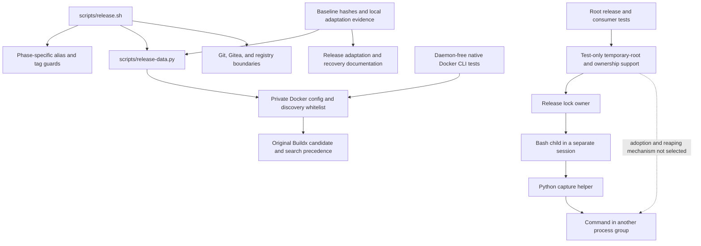

# Brooks-Lint Health Dashboard

- [Brooks-Lint Health Dashboard](#brooks-lint-health-dashboard)
  - [Dimension Scores](#dimension-scores)
  - [Module Dependency Graph](#module-dependency-graph)
  - [Test Suite Map](#test-suite-map)
  - [Top Findings](#top-findings)
    - [Warning](#warning)
  - [Verification and Limits](#verification-and-limits)
  - [Recommendation](#recommendation)

**Mode:** Health Dashboard

**Scope:** Plan review of `tasks/02-fix-release-review-warnings/2-plan.md` at commit `7fb52d1`, checked against its goal, the preceding four code-review warnings, current release scripts, and the publication/consumer test boundaries. This evaluates the proposed changes, not implemented fixes or whole-project health. No `.brooks-lint.yaml` exists; balanced defaults apply.

**Composite Score:** 99/100

**Trend:** Previous Health Dashboard score 95, numerically up 4. That record reviewed implemented task 01 code, not this proposed task, so the scores are not a comparable improvement trend.

Clarify the forced-timeout supervision mechanism before implementation; the other three fixes and the publication boundaries are sufficiently specified. No critical findings or publication approval.

## Dimension Scores

- Code Quality: 100/100, weight 0.25. No additional R1/R2 finding in the proposed changes. Phase-specific alias validation, bounded configuration parsing, and a small test-support boundary have clear responsibilities.
- Architecture: 100/100, weight 0.30. No additional R5 finding. The plan preserves the Bash/Python boundary, confines process supervision to tests, and tests native Docker discovery rather than equating fake routing with executable selection.
- Tech Debt: 100/100, weight 0.25. No additional R1-R6 finding. Local patches are explicit rather than mislabeled as upstream copies, historical script identities are preserved, and version duplication remains a checked metadata contract. The timeout ownership gap is counted only under Test Quality.
- Test Quality: 95/100, weight 0.20. One T2 warning: graceful forwarding is actionable, but the fallback does not specify who can adopt and reap orphaned descendants after forced ancestor termination.

Balanced scoring subtracts 5 for the single warning. Composite: `100 × 0.25 + 100 × 0.30 + 100 × 0.25 + 95 × 0.20 = 99`. One warning, no critical findings, and no suggestions are counted. The four preceding implementation warnings are the subject of this plan; they are not counted again as new plan findings.

## Module Dependency Graph

Proposed release and test boundaries, not an application-wide import graph. The unresolved edge is process adoption/reaping during escalation, not an import cycle.

## Test Suite Map

- Existing release baseline: 125 discovered Python cases, consisting of five interface tests, 29 data/helper tests, 83 subprocess publication cases, and eight consumer checks. These counts come from the preceding review; this planning review did not rerun the suite.
- Planned N1 coverage: precise post-confirmation injections for the old predecessor, absent alias, foreign alias, and failed or invalid reads; assert no subsequent remote write and retain supported pre-promotion/retry paths.
- Planned N2 coverage: native Docker CLI tests with temporary metadata/marker plugins, actual private-auth preparation, ordered search directories, relative configuration, competing candidates, and refusal behavior. Fake context/host/builder tests remain complementary. CLI absence is an explicit skip and prevents declaring N2 verified.
- Planned timeout coverage: synchronized command/descendant waits, forced short timeout, graceful cleanup, escalation, normal exit, nonzero exit, lock release, and absence of delayed mutation. The escalation ownership/reaping mechanism needs the revision below.
- Planned portability coverage: real temporary-directory creation with present and absent preferred paths, plus representative consumer/helper behavior. Shared `/tmp/opencode` is not removed or modified to manufacture the absent-path scenario.
- Existing application context: 39 Vitest files and 253 cases; browser context: five Playwright spec files and 30 configured desktop/mobile cases. The plan retains static/unit/build checks but deliberately does not claim new browser or dual-architecture runtime acceptance. That scope is appropriate for release-tooling fixes and does not waive outstanding release gates.

## Top Findings

### Warning

**1. T2 — Escalation requires an explicit adoption/reaping boundary, not only descendant discovery**

Symptom: `2-plan.md:48-52` proposes `Popen`, graceful SIGTERM forwarding, tracking descendant/session identities, and ownership-checked escalation. Its acceptance criterion at `2-plan.md:83` requires terminating and reaping owned descendants across session boundaries. The current lock owner creates a separate Bash child session at `scripts/release-data.py:668`, and `capture()` creates another session for commands at `scripts/release-data.py:153-155`. The plan does not select a mechanism that keeps those descendants waitable by the test harness when an intermediate parent is forcibly killed. Ordinary `Popen.wait()` or `os.waitpid()` in the harness cannot reap arbitrary grandchildren; PID/start-time tracking establishes identity, not parenthood. Cleanup ordering and bounded descendant discovery must also survive the intermediate parent's exit.

Source: *xUnit Test Patterns* — Erratic Test and fixture teardown; *The Art of Unit Testing* — test isolation; *Working Effectively with Legacy Code* — explicit sensing and separation seams.

Consequence: The normal graceful path may pass while escalation still leaves orphaned or zombie processes outside the harness's wait boundary. Waiting on the original process can finish before descendants release inherited pipes or locks, producing hangs or unreliable cleanup assertions. An implementer must invent substantial Linux-specific supervision behavior to satisfy the stated acceptance criterion, or silently weaken it to checking that recorded PIDs disappeared.

Remedy: Amend step 4 with a concrete test-only ownership/adoption strategy established before release launch. One viable Linux design is a dedicated per-invocation supervisor using child-subreaper semantics, with a readiness handshake before spawning, bounded graceful forwarding, ownership-verified descendant termination, and reaping of adopted children before reporting completion. An equivalent demonstrated containment mechanism is acceptable; a process-group kill or a late ancestry scan alone is not. Specify how process identity is checked, when the lock owner may be killed, how pipes are drained without unbounded waits, and which owned temporary paths the harness removes after forced termination prevents shell traps. Keep this capability local to the invocation, report unsupported-platform behavior explicitly, and test an intermediate parent exiting while a descendant ignores SIGTERM, alongside the existing cooperative case. Do not modify production scripts solely to make the test harness own its processes.

## Verification and Limits

- This is a design review only. No release regressions, application checks, native Docker probes, database/browser runs, image builds, or publication commands were executed.
- Checked the proposed alias-lifecycle fix against current `alias_guard`, the promotion-confirmation read, and the release-POST boundary. The plan retains the necessary pre-promotion predecessor acceptance and separately tightens post-confirmation checks.
- Checked plugin preservation against current `auth()`, which creates a minimal Docker config and copies context metadata but does not preserve plugin discovery. The planned whitelist, absolute candidate bridge, bounded parsing, credential isolation, and native CLI tests address the observed N2 boundary. Whether they work remains implementation evidence, not a planning conclusion.
- Checked ordinary and special publication-test launch/cleanup paths against the multiple `start_new_session=True` boundaries. The one warning concerns the unselected escalation ownership mechanism; it does not reattribute earlier intermittent test failures to an unproven cause.
- The plan correctly preserves all 125 existing cases, root discovery, consumer hash protection, explicit local adaptations, historical checkout identities, current `next-env.d.ts` work, and the distinction between source version `0.7.9` and proven remote availability.
- Only this review and the health-history record are changed. `2-plan.md`, implementation files, historical task reports, and unrelated workspace changes remain untouched. Publication, privileged installation, and destructive recovery remain outside this task.

## Recommendation

Update the timeout-supervision portion of `2-plan.md` before implementation, then keep the rest of its scope intact. Test Quality needs the most attention: use a focused test-harness review to verify adoption, escalation, lock release, output draining, and teardown ordering once the ownership design is concrete. The plan otherwise addresses the four previous warnings without silently changing the upstream pin or weakening publication safety. Passing these focused fixes will not establish successful image builds, browser acceptance, authenticated version availability, exclusive writers, or clean pushed-main readiness; live publication remains separately gated.
