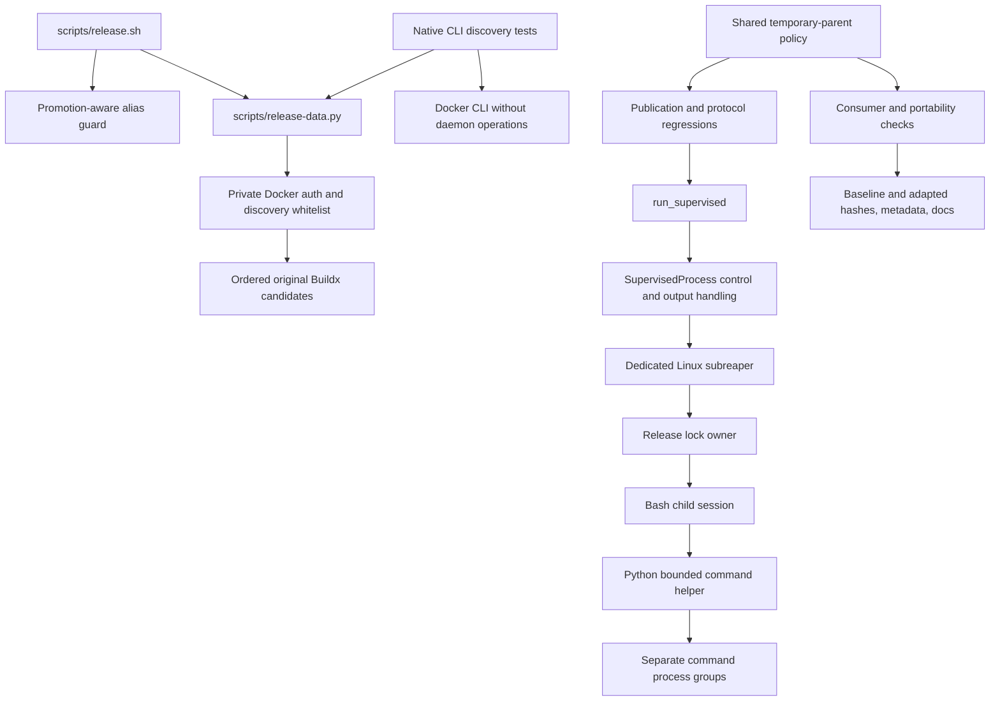

# Brooks-Lint Health Dashboard

- [Brooks-Lint Health Dashboard](#brooks-lint-health-dashboard)
  - [Dimension Scores](#dimension-scores)
  - [Module Dependency Graph](#module-dependency-graph)
  - [Test Suite Map](#test-suite-map)
  - [Top Findings](#top-findings)
    - [Warning](#warning)
  - [Previous Warning Disposition](#previous-warning-disposition)
  - [Verification and Limits](#verification-and-limits)
  - [Recommendation](#recommendation)

**Mode:** Health Dashboard

**Scope:** All 23 committed files in `01-update-build-image...b8ee0d6` on `02-fix-release-review-warnings`, with stacked-branch base `bbd925c6f8157936bb1cae68867bb8ca2d00fed2`. This is the immediate parent branch and implementation fork point. Local `main...HEAD` contains 39 files because the earlier adoption and planning work is not merged; those inherited changes were reviewed previously and serve as context here. Reviewed protocol patches, supervision/support code, all added/modified tests, metadata, documentation, and implementation evidence. No `.brooks-lint.yaml` exists; balanced defaults apply. The unrelated modified `next-env.d.ts` is excluded and preserved.

**Composite Score:** 98/100

**Trend:** Previous Health Dashboard score 99 for this task's proposed plan; numerically down 1, but a plan review is not a comparable implemented-code trend. The preceding implementation review scored 95 on a different branch scope.

The N1/N2 protocol fixes and temporary-directory portability are supported by the diff and passing regressions. Two supervision edge cases remain: launch-failure ownership and forced-cleanup observability. Fix them before declaring timeout remediation complete; this review does not approve publication.

## Dimension Scores

- Code Quality: 95/100, weight 0.25. One R1 warning: launch, ownership registration, and cleanup span different exception boundaries, leaving failures between them unprotected.
- Architecture: 100/100, weight 0.30. No additional R5 finding. Production orchestration remains Bash/Python; Linux adoption is confined to a separate test process. Native plugin discovery is tested separately from fake service routing. The launch-boundary defect is counted only under Code Quality.
- Tech Debt: 100/100, weight 0.25. No additional R1-R6 finding. Baseline/local provenance, synchronized source metadata, historical identities, and operator-controlled executable assumptions are explicit. Supervision complexity is justified by the reviewed cross-session requirements; its length alone is not scored.
- Test Quality: 95/100, weight 0.20. One T5 warning: the ordinary release wrapper discards forced-teardown evidence after the harness has repaired the fixture state that existing cleanup assertions inspect.

Balanced scoring subtracts 5 per warning from its assigned dimension. Composite: `95 × 0.25 + 100 × 0.30 + 100 × 0.25 + 95 × 0.20 = 97.75`, rounded half-up to 98. Two warnings, no critical findings, and no suggestions are counted once each.

## Module Dependency Graph

Changed release and test boundaries only; no application-wide import graph or newly introduced import cycle was found.

## Test Suite Map

- Current Python suite: 139 discovered methods, retaining the original 125 scenarios. Baseline methods remain five interface, 29 data/helper, 83 subprocess publication, and eight consumer cases. Added coverage comprises six adaptation methods and eight supervision/portability methods; subtests provide additional scenarios without increasing these counts.
- Publication cases run the real release entry point against temporary Git repositories and fake command ports. Native plugin tests use the actual Docker CLI with temporary metadata/marker plugins and no daemon, registry, or user token. These are local integration/boundary tests, not live publication or application-image tests.
- During this review, all 56 interface/helper/consumer/adaptation/supervision methods passed in 46.054 seconds with no skips. Existing full-run evidence records all 139 methods passing in 874.457 seconds. The full 14-minute suite was not rerun again for this review.
- Existing application context remains 39 Vitest files and 253 passing cases in the implementation evidence. Browser context remains five Playwright spec files and 30 configured desktop/mobile cases, not reverified after Chromium installation. No application, Dockerfile, migration, or Compose behavior changes belong to this branch.
- Existing tests cover capability refusal before launch, cooperative timeout, orphan adoption/escalation, cancellation/EOF, output overflow, PID acquisition races during discovery, and temporary-root fallback. They do not cover loss of the launch acknowledgement or failure of the root's initial PID-handle acquisition. Nor do ordinary publication cases assert that forced teardown was unnecessary.

## Top Findings

### Warning

**1. R1 — Launch ownership is established after operations that can already fail (Code Quality)**

Symptom: `tests/release_test_support.py:85-98,176-179` starts the release inside `__enter__`. If `start()` sends the start request but receiving its acknowledgement fails, Python does not invoke `__exit__`; `run_supervised` has no surrounding launch `try/finally`. `started` remains false until after acknowledgement. On the supervisor side, `tests/release_supervisor.py:106-117` creates the root, opens its PID handle, and announces it before entering the teardown-protected `try`. Injecting a lost acknowledgement after readiness reproduced zero automatic `close()` calls while the supervisor and release child stayed alive. Independently injecting `EMFILE` into the root's initial `pidfd_open` reproduced `supervise()` raising with its spawned child still alive. Both probes were explicitly terminated/reaped afterward. The special publication-test launcher registers cleanup before `start()`, but the common wrapper does not.

Source: *Code Complete* — High-Quality Routines, exception safety, and defensive error paths; *A Philosophy of Software Design* — reducing lifecycle complexity through explicit ownership boundaries.

Consequence: A launch-time infrastructure failure can escape before cancellation, adoption, and reaping are awaited. The ordinary publication fixture retains its directory on `SupervisionError`, but the processes may continue until some later observer closure or garbage collection triggers cleanup. Failure of initial root-handle acquisition bypasses the supervisor's emergency cleanup entirely. Passing discovery-race and pre-launch capability tests does not establish safety at these later boundaries.

Remedy: Establish cleanup ownership before requesting child start and cover constructor/entry/start failures with an explicit lifetime guard; do not rely on `__exit__` when `__enter__` raises. On the supervisor side, move the root launch and initial handle acquisition inside a teardown-protected lifecycle with optional/uninitialized handles. If acquiring a root pidfd fails, safely terminate/reap the known direct child while preserving descendant adoption and bounded cleanup; never signal an unverified arbitrary PID. Add synchronized fault-injection regressions for acknowledgement loss and initial root-handle failure, proving that failure reporting waits for owned teardown and that the fixture is retained when teardown cannot be proved. Keep these fixes test-only and preserve the normal 90-second limit.

**2. T5 — Ordinary publication assertions cannot distinguish production cleanup from harness repair (Test Quality)**

Symptom: `tests/release_test_support.py:147-159` deletes recorded run directories whenever supervisor status says `forced`. `run_supervised` at `tests/release_test_support.py:176-179` then returns only an ordinary `CompletedProcess`, discarding `forced` and other teardown evidence. `tests/test_bash_release.py:142-151` checks for absent `bash-release.*` directories only after this deletion. A disposable probe whose root exited 0 while leaving a synchronized, SIGTERM-ignoring descendant and a run directory returned status 0 through `run_supervised`; the descendant was forcibly reaped and the directory removed, with no forced-cleanup field exposed to the caller. The dedicated escalation regression can inspect `SupervisedProcess.status`, but ordinary release scenarios cannot.

Source: *xUnit Test Patterns* — fixture teardown and verification ordering; *How Google Tests Software* — change coverage rather than passing-count confidence; *The Art of Unit Testing* — completeness of observable side-effect assertions.

Consequence: An ordinary release case can appear to satisfy process/temp-state cleanup even when the production path leaked descendants and only the harness repaired it. The harness correctly contains the leak, but the existing assertion no longer distinguishes the behavior under test from teardown performed by the test framework. This weakens the claim that cooperative production cleanup and forced harness cleanup remain separately verified.

Remedy: Preserve teardown evidence in the result or an explicit supervisor result object, and make ordinary publication scenarios fail if unexpected forced cleanup was necessary. Assert production trap/process cleanup before applying harness repair where possible. Allow forced cleanup explicitly only in regressions that intentionally exercise escalation, while still performing containment before propagating failure. Add a negative harness regression where a zero-exit root leaks a descendant/run directory: teardown must remain safe, but the ordinary release helper must not report an unqualified passing case. Do not remove escalation cleanup merely to restore the assertion.

## Previous Warning Disposition

- N1: addressed in the reviewed production patch. `promotion_confirmed` is set only after the explicit prepared-digest read; `alias_guard` subsequently rejects the predecessor and absence before release POST. The precise predecessor/absence/foreign/invalid-read subcases passed during this review. Earlier acceptance and supported retry behavior remain in the recorded full suite. This is not an atomic guard against concurrent external changes.
- N2: addressed for the documented discovery contract. The helper preserves ordered extra directories and the config-local candidate without original auth/helper inventory. Five native Docker discovery methods passed during this review, alongside the existing full-suite connection tests. Referenced binaries remain trusted operator inputs; no binary-immutability, real daemon-routing, or TLS certification is inferred.
- Timeout descendants: cooperative and escalation paths are substantially improved and tested, including PID-safe discovery races. The launch-exception gap and hidden forced-cleanup evidence above prevent treating this dimension as complete.
- Temporary-parent portability: addressed. The shared selector prefers an existing usable harness directory and otherwise uses the platform temporary root. The present/absent tests create actual fixtures and exercise consumer/bearer behavior without altering shared paths.
- The plan review requested a concrete adoption/reaping mechanism. A per-invocation subreaper now supplies that mechanism; the new finding concerns where its ownership guards begin, not absence of an adoption design.

## Verification and Limits

- During this review, shell syntax, missing-token `--validate`, and `git diff 01-update-build-image...HEAD --check` passed. Offline validation reported no credentials or remote operations.
- During this review, `python3 -B -m unittest tests.test_bash_release.BashInterfaceTests tests.test_bash_release.BashDataTests tests.test_consumer_release tests.test_release_adaptations tests.test_release_supervision -v` passed all 56 methods in 46.054 seconds, with no skips. Its log is `/tmp/opencode/my-library-task02-review-tests.log`.
- Review probes used temporary directories and isolated processes only. Acknowledgement loss and root-handle acquisition failure were injected without changing tracked code. Probe-owned surviving processes were explicitly stopped and reaped. The forced-cleanup probe completed through the actual supervisor, which contained and reaped its orphan. A closed-output timeout probe still raised `TimeoutExpired`; no timeout-bypass finding is made.
- The completed full log records 139 methods passing in 874.457 seconds. Earlier failed implementation runs and the reproduced/fixed `EINVAL` acquisition race remain documented in `4-implemented.md`; this review does not erase them or attribute the new launch-failure probes to that old race.
- Reviewed all 23 changed files. Source version/lockfile/configured notes/operator links agree at provisional `0.7.9`; baseline hashes and adapted bytes remain separately checked. The documentation appropriately avoids claiming that upstream bytes were unchanged or that runtime/image acceptance is complete.
- No application checks, database/browser runs, image builds, live inventories, real credential reads, source pushes, remote mutations, privileged setup, or destructive recovery were performed in this review. Implementation evidence records passing formatting, lint, type checking, 253 application tests, and production build; those checks were not repeated here.
- Image-build/runtime acceptance, disposable-database browser verification, authenticated version availability, service permissions, exclusive writers, and clean already-pushed `main` remain independent release gates. This is a stacked implementation branch with unrelated workspace work, not an approved publication checkout.
- Only this report and the health-history record change. No implementation fixes or changes to the plan, implementation report, historical reviews, or unrelated `next-env.d.ts` are applied.

## Recommendation

Request the two test-harness revisions before closing the timeout warning: establish guarded ownership across both launch failure windows, then expose and assert forced-teardown evidence in ordinary publication cases. A focused test-quality review of those exceptional paths is more useful than another unchanged happy-path full-suite run. The production N1/N2 patches and portability changes are supported by this review, but the composite score and passing regression counts are not publication approval. Preserve the existing independent release-readiness gates and non-destructive recovery contracts.
