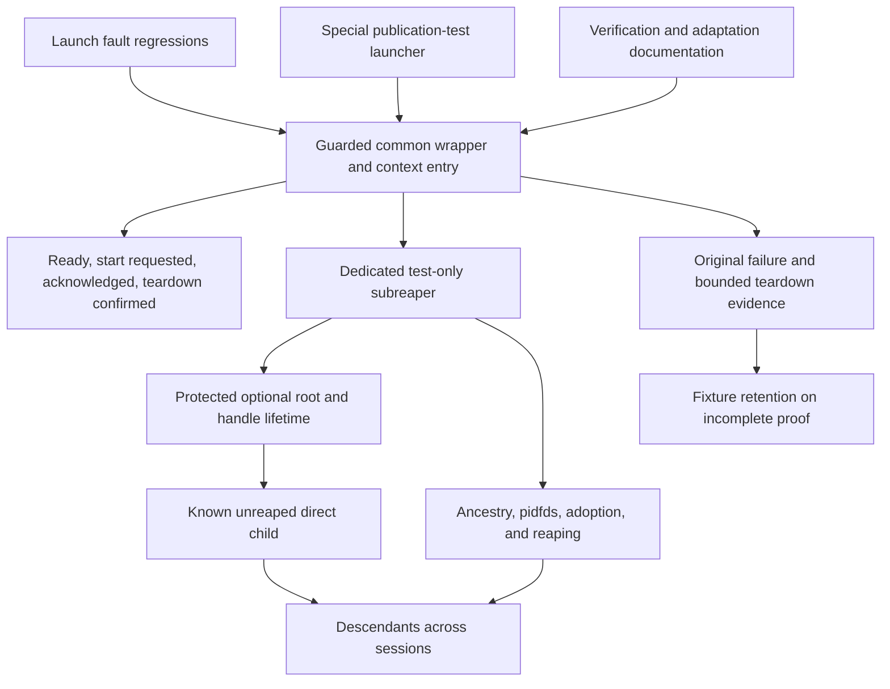

# Brooks-Lint Health Dashboard

- [Brooks-Lint Health Dashboard](#brooks-lint-health-dashboard)
  - [Dimension Scores](#dimension-scores)
  - [Module Dependency Graph](#module-dependency-graph)
  - [Test Suite Map](#test-suite-map)
  - [Top Findings](#top-findings)
  - [Verification and Limits](#verification-and-limits)
  - [Recommendation](#recommendation)

**Mode:** Health Dashboard

**Scope:** Plan review of `tasks/03-fix-launch-ownership/2-plan.md` at commit `255b999`, checked against its goal, R1 in the previous branch review, and current caller/supervisor launch and fixture-retention code. This scores the proposed R1 remediation, not implemented code, T5 remediation, or whole-project health. No `.brooks-lint.yaml` exists; balanced defaults apply.

**Composite Score:** 100/100

**Trend:** Previous Health Dashboard score 98 for implemented task 02 code; numerically up 2, but the different scope and review stage make this unsuitable as a measured code-quality improvement trend.

The plan addresses both reproduced launch-ownership windows with explicit lifecycle states, bounded cleanup, and behavioral regressions. No new findings; implementation verification and the separate T5 warning remain outstanding.

## Dimension Scores

- Code Quality: 100/100, weight 0.25. No R1/R2 finding in the proposal. Cleanup ownership precedes dispatch, failed context entry is handled explicitly, and partial construction/root acquisition are inside protected lifetimes.
- Architecture: 100/100, weight 0.30. No R5 finding. Changes remain in the test-harness boundary; subreaper behavior stays invocation-local. The raw-PID exception is limited to the supervisor's known unreaped direct child, while discovered descendants retain ancestry/pidfd ownership.
- Tech Debt: 100/100, weight 0.25. No additional R1-R6 finding. The plan avoids a new supervision framework, keeps production protocol bytes and provenance hashes fixed, and treats version/notes changes as explicit source bookkeeping rather than published evidence. T5 policy is deliberately not folded into this fix.
- Test Quality: 100/100, weight 0.20. No new T1/T2 finding. Regressions must prove actual owned-child termination/reaping, exception preservation, and fixture retention; mocked call counts alone do not satisfy acceptance. Existing cases, timeout limits, and unrelated-process protection are retained.

No findings are deducted. Composite: `100 × 0.25 + 100 × 0.30 + 100 × 0.25 + 100 × 0.20 = 100`. Zero critical findings, warnings, and suggestions. This score describes the plan's completeness within its stated scope, not the current implementation's correctness.

## Module Dependency Graph

Proposed ownership boundaries, not an application-wide dependency graph. No new import-cycle or production-to-test dependency is proposed.

## Test Suite Map

- Existing Python baseline: 139 methods, comprising five interface, 29 data/helper, 83 publication, eight consumer, six adaptation, and eight supervision/portability methods. These counts and the prior passing full run are implementation evidence from task 02, not rerun results from this planning review.
- Planned acknowledgement coverage: actual child launch followed by lost, malformed, delayed, or unavailable acknowledgement; cancellation may encounter an outstanding `started` message. Separate coverage handles failure before any root exists and repeated/idempotent cleanup.
- Planned supervisor coverage: root `Popen` failure, initial root-handle acquisition failure after spawn, partial setup, and bounded cleanup of a root without a pidfd. Synchronized descendants and an unrelated control process verify adoption and signaling boundaries.
- Planned retention coverage: simulated incomplete teardown reaches `BashPublicationTests`, retains the disposable fixture, and preserves the launch exception as context. An outer regression owner prevents the test itself from leaking real processes; no unkillable host process or modified shared resource limit is required.
- Planned verification preserves all 139 current methods/scenarios and adds the new cases, followed by complete discovery, offline validation, shell syntax, formatting, lint, type checking, application unit tests, and production build. Capability skips do not certify R1 cleanup.
- Existing application context is 39 Vitest files and 253 cases; browser context is five Playwright spec files and 30 configured desktop/mobile cases. Image builds and database/browser acceptance remain separate release work, appropriately excluded from this focused harness task.

## Top Findings

No new findings within the requested R1 scope. The current code still has the previously reviewed defect; this section evaluates whether the plan addresses it, not whether planning has already fixed it.

The caller-side requirements at `2-plan.md:29-33` cover failed `__enter__`, possible start dispatch before acknowledgement, stale launch messages, partial construction, idempotence, and preservation of original failure evidence. These directly address `tests/release_test_support.py:85-98,162-179`, where start currently precedes guaranteed common-wrapper cleanup.

The supervisor requirements at `2-plan.md:37-41` cover root launch and initial pidfd acquisition before success acknowledgement, optional/uninitialized handles, safe direct-child fallback, descendant adoption, and bounded incomplete-proof reporting. These directly address `tests/release_supervisor.py:106-117`, where creation/acquisition currently precede the protected `try`.

T5 remains a known implementation warning, intentionally excluded by `1-goal.md` and `2-plan.md:49,56,80`. It is neither resolved nor newly scored as a defect in this focused plan. The proposed conventional version bump is explicitly bookkeeping and does not authorize protocol changes, remote reservation, or publication.

## Verification and Limits

- This is a read-only design review apart from its report/history outputs. No regression suite, native CLI probe, application build, browser/database run, image build, or publication command was executed.
- Inspected current common launch/context/close paths, the supervisor's pre-`try` launch sequence, publication fixture retention, and existing supervision tests. Existing pre-launch capability and descendant-discovery fault tests do not cover initial root acquisition or lost launch acknowledgement; the plan adds those distinct cases.
- Checked the distinction between a known unreaped direct child and an arbitrary observed PID. The plan keeps all fallback decisions in the dedicated supervisor and forbids signaling that numeric PID after reaping or extending the fallback to unverified descendants.
- Persistent resource exhaustion is not promised away: if safe descendant acquisition or complete teardown cannot be proved, the plan requires bounded explicit failure and retained fixtures. Implementation must demonstrate those outcomes rather than replacing them with a success summary or unsupported-capability skip after launch.
- Only this review and the health-history record change. `2-plan.md`, implementation files, historical task reports, and unrelated `next-env.d.ts` remain unchanged. Source `0.7.10` remains provisional future implementation bookkeeping.

## Recommendation

Proceed with the planned R1 implementation without expanding it to T5. Keep cleanup registration before dispatch and optional root/handle state at the center of the change; validate both reproduced failure windows with actual child-process assertions before running the complete suite. Review the resulting ownership and exception paths after implementation. This planning approval does not close R1 in current code or waive T5, image/runtime/browser acceptance, authenticated version availability, exclusive writers, clean pushed-main preparation, or other publication gates.
