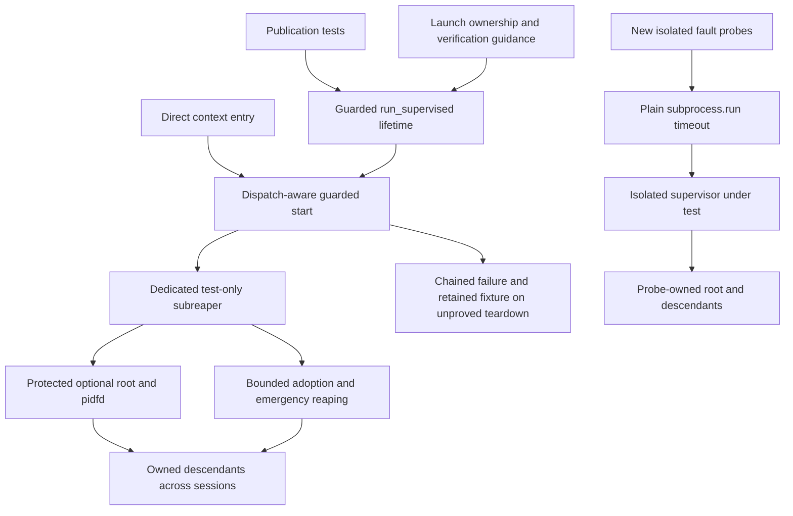

# Brooks-Lint Health Dashboard

- [Brooks-Lint Health Dashboard](#brooks-lint-health-dashboard)
  - [Dimension Scores](#dimension-scores)
  - [Module Dependency Graph](#module-dependency-graph)
  - [Test Suite Map](#test-suite-map)
  - [Top Findings](#top-findings)
    - [Warning](#warning)
  - [R1 Disposition and Scope](#r1-disposition-and-scope)
  - [Verification and Limits](#verification-and-limits)
  - [Recommendation](#recommendation)

**Mode:** Health Dashboard

**Scope:** All 14 committed files in `02-fix-release-review-warnings...bfd20ac` on `03-fix-launch-ownership`, with immediate parent/fork point `15d6af59c5078944f6c68d00c1e461ccb49bb10f`. Reviewed the R1 caller/supervisor changes, all added launch regressions, fixture integration, metadata, documentation, and implementation evidence. Earlier stacked release changes are context, not new changes in this review. No `.brooks-lint.yaml` exists; balanced defaults apply. The unrelated modified `next-env.d.ts` is excluded and preserved.

**Composite Score:** 99/100

**Trend:** Previous Health Dashboard score 100 for this task's plan; numerically down 1, but design and implementation reviews are not directly comparable quality measurements.

The original R1 launch windows are addressed and supported by behavioral regressions. One new test-isolation warning remains: the isolated fault probes can lose their cleanup owner when their outer timeout kills that owner. T5 remains explicitly deferred; this review does not approve publication.

## Dimension Scores

- Code Quality: 100/100, weight 0.25. No new R1/R2 finding. Guarded start tracks possible dispatch independently of acknowledgement, and partial construction/failed context entry share explicit cleanup. Optional root/handle state covers acquisition failures without changing production protocol code.
- Architecture: 100/100, weight 0.30. No new R5 finding. Subreaper behavior remains in a dedicated test process. Direct-child signaling without a pidfd is restricted to an unreaped known child, with default SIGCHLD restored locally; discovered descendants retain ancestry/pidfd ownership.
- Tech Debt: 100/100, weight 0.25. No additional R1-R6 finding. The changes preserve protocol hashes, existing result shape, and the documented T5 boundary. Source metadata and notes remain a synchronized bookkeeping contract, not publication evidence. Additional lifecycle handling is justified by the reproduced exceptional paths rather than scored by length alone.
- Test Quality: 95/100, weight 0.20. One T2 warning: two new fault probes use a parent-only timeout around the process that owns cleanup for their spawned descendants.

Balanced scoring subtracts 5 for the one warning. Composite: `100 × 0.25 + 100 × 0.30 + 100 × 0.25 + 95 × 0.20 = 99`. One warning, no critical findings, and no suggestions are counted. The inherited, intentionally excluded T5 warning is not counted again as a new defect in this branch.

## Module Dependency Graph

Changed ownership/test boundaries only; no new import cycle or production-to-test dependency was found.

## Test Suite Map

- Current Python suite: 149 methods. Five interface, 29 data/helper, 83 publication, eight consumer, six adaptation, and 18 supervision/portability methods. Ten launch-ownership methods were added while retaining all previous 139 methods/scenarios.
- New behavioral checks cover consumed/unread/malformed acknowledgements, failed context entry, interruption, send-before-dispatch failure, partial sockets/spawn/readiness setup, root spawn/acquisition failure, separate-session descendants, lock release, unrelated-process isolation, and simulated incomplete-proof retention.
- Existing coverage retains native daemon-free plugin discovery, protocol refusal/retry scenarios, and fake service ports. Those remain local integration/boundary checks, not live publication or application-image verification.
- During this review, all 60 supervision/interface/helper/consumer methods passed in 2.764 seconds with no skips. The recorded complete implementation run passed all 149 methods in 881.295 seconds; that 14-minute run was inspected, not repeated for this review.
- Application context remains 39 Vitest files and 253 passing cases in the implementation record. Five browser spec files and 30 configured desktop/mobile cases remain separate, unverified release-readiness work. No application or image behavior changed in this branch.

## Top Findings

### Warning

**1. T2 — The fault probe's outer timeout can kill its cleanup owner before descendant teardown**

Symptom: `tests/test_release_supervision.py:201-242,374-438` runs an isolated supervisor/fault program through plain `subprocess.run(..., timeout=10)`. Its outer cleanup owner is a `finally` block inside that same isolated process. If the program stalls after spawning its root or descendants, `subprocess.run` kills the immediate probe process on timeout; SIGKILL does not execute its `finally`, and the unittest caller has no independently surviving adoption/reaping boundary for those children. In a disposable review copy, a pause was injected after the actual root launch and the outer timeout shortened to 0.5 seconds. Calling the real initial-root-acquisition test method then raised `TimeoutExpired` while the probe root remained alive. An additional independent review supervisor adopted and forcibly reaped it afterward. Tracked code was not modified.

Source: *xUnit Test Patterns* — Erratic Test and fixture teardown; *The Art of Unit Testing* — test isolation and ownership of external resources.

Consequence: The regressions intended to prove leak-free launch failure can themselves leave orphaned processes when the code under test hangs or a fault probe exceeds its deadline. Their normal passing results and internal `finally` cleanup do not protect the timeout path. Later tests can inherit resource contention, and fixture finalization can run while probe descendants still exist. This is a new fault-probe containment gap, not a recurrence of the now-guarded common release-launch path.

Remedy: Run descendant-spawning isolated fault probes under an independently surviving invocation owner, using the existing supervision support where feasible rather than introducing another process framework. Confine injected failures to the inner supervisor under test, not the outer containment owner. On an outer probe timeout, require that outer owner to terminate/adopt/reap the probe tree before propagating failure or deleting fixtures. Keep the inner `finally` as cooperative cleanup, and add a deliberate post-spawn stall regression proving timeout containment and unrelated-process preservation. Do not merely remove/increase the timeout or rely on a process-group kill across the existing separate-session boundaries.

## R1 Disposition and Scope

- Caller lifetime: addressed. `run_supervised` now guards cleanup before `start()`, and `start()` itself cleans up failed context entry. `start_requested` is set before dispatch, so an unread acknowledgement no longer implies no child. Cancellation can consume a pending `started` message before final status. Original launch exceptions survive successful cleanup; incomplete proof is chained and retained.
- Partial construction: addressed. Initialized sockets and pre-start supervisor resources are closed/reaped on constructor failure. Before START, teardown cannot own a release tree; after possible dispatch, cleanup uses the supervised path. Repeated cleanup is idempotent.
- Root acquisition: addressed. Root `Popen`, initial `pidfd_open`, and announcement are now inside the protected lifetime. A root without a pidfd is signaled only while it remains the supervisor's known unreaped direct child. Local default SIGCHLD handling supports that PID-reservation assumption. Descendants do not receive unverified raw-PID signals.
- Evidence: current launch tests prove root/descendant reaping before failure delivery, acquirable locks, constructor cleanup, original exception context, and fixture retention. The additional warning above concerns containment of the isolated test programs themselves when their outer execution timer fires.
- T5: unchanged and intentionally outside scope. Normal `CompletedProcess` results still do not expose forced cleanup to ordinary publication assertions. Nothing in this report closes that earlier warning or alters its priority.
- Production protocol scripts, fake ports, and consumer provenance/hash assertions are unchanged relative to the parent branch. Version `0.7.10`, npm metadata, notes configuration, release heading, and operator link agree; the source bump is not a remote reservation or publication.

## Verification and Limits

- During this review, `python3 -B -m unittest tests.test_release_supervision tests.test_bash_release.BashInterfaceTests tests.test_bash_release.BashDataTests tests.test_consumer_release -v` passed all 60 methods in 2.764 seconds, with no skips. Log: `/tmp/opencode/my-library-task03-review-tests.log`.
- Shell syntax, missing-token `./scripts/release.sh --validate`, and `git diff 02-fix-release-review-warnings...HEAD --check` passed. Validation reported no credentials or remote operations. Consumer checks include metadata, unchanged adapted hashes, validation isolation, and local diagnostic/document references.
- Inspected the completed implementation log: 149 methods passed in 881.295 seconds. The implementation record transparently notes that the final SIGCHLD safeguard/assertion was also verified by a supplemental targeted run. This review's current 60-method run includes that safeguard.
- The timeout probe used an owned temporary copy of the supervisor with a local post-spawn pause, the existing initial-root test method, and a shortened outer timer. It demonstrated the live orphan before the separate review containment owner reaped it. No production process, service, credential, shared directory, or tracked implementation file was changed.
- Formatting, lint, type checking, 253 application tests, and application build passed during implementation; they were not rerun for this read-only review. No image build, database/browser run, remote inventory, source push, live release, registry/package mutation, privileged setup, or destructive recovery was attempted.
- Existing image/runtime/browser acceptance, authenticated version availability, permissions, exclusive writers, and clean already-pushed `main` remain separate release gates. A passing health score or local regression suite does not waive them.
- Only this report and the health-history record change. The plan, implementation record, historical reports, implementation code, and unrelated `next-env.d.ts` remain unchanged.

## Recommendation

The original R1 fix is supported by this review. Address the new outer-probe timeout isolation warning before treating the launch regressions as self-containing under failure, while leaving T5 remediation separate as requested. A focused test-quality check of that containment boundary is more useful than another unchanged full-suite run. Keep the independent publication-readiness gates closed until their own evidence and review are complete; this review performs no fixes or publication approval.
