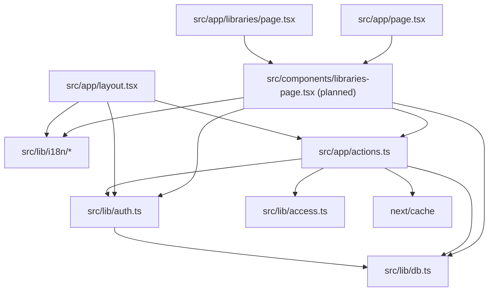

# Brooks-Lint Health Dashboard

- [Brooks-Lint Health Dashboard](#brooks-lint-health-dashboard)
  - [Scope And Verdict](#scope-and-verdict)
  - [Dimension Scores](#dimension-scores)
  - [Module Dependency Graph](#module-dependency-graph)
  - [Test Suite Map](#test-suite-map)
  - [Top Findings](#top-findings)
    - [Warning](#warning)
    - [Suggestion](#suggestion)
  - [Recommendation](#recommendation)
  - [Verification](#verification)

## Scope And Verdict

**Mode:** Health Dashboard

**Scope:** Plan review of `tasks/13-library-list-front-page/2-plan.md`, checked against `1-goal.md` and the current routes, authentication, mutation actions, localization, test patterns, and verification configuration.

**Composite Score:** 98/100

The plan is implementable and preserves the existing access boundary. Refine two test steps before implementation; no critical design issue was found.

This score measures the proposed change and its verification plan, not overall repository health or completed implementation quality. No `.brooks-lint.yaml` exists, so balanced scoring applies. The unrelated `next-env.d.ts` working-tree change is excluded.

## Dimension Scores

- Code Quality: Not applicable. No implementation diff exists for this task; the plan is assessed through the remaining dimensions.
- Architecture: 100/100. Both routes share one server implementation, with authentication before the owner-or-member query. No new dependency cycle or domain-to-infrastructure inversion is proposed.
- Tech Debt: 100/100. The R1–R6 scan found no actionable plan-level issue. The existing Prisma record and direct server-page query are appropriate for this small CRUD view. Coordinated edits to its routes, navigation, and invalidation are one feature change, not Shotgun Surgery.
- Test Quality: 94/100. One Warning for extending an Eager Test and one Suggestion for incomplete browser verification of the freshness criterion.

Balanced deductions are 5 per Warning and 1 per Suggestion. With Code Quality omitted, the composite is `round-half-up((100 × 0.30 + 100 × 0.25 + 94 × 0.20) / 0.75) = 98`. Findings are counted once in their owning dimension.

## Module Dependency Graph

Arrows show imports or calls in the proposed design. The graph summarizes the affected dependency paths, rather than claiming a whole-repository cycle analysis.

Keeping both route files as thin exports avoids importing one App Router page into another. `requireUser()` currently rejects missing, expired, and disabled user sessions independently of administrator authentication (`src/lib/auth.ts:93–120`). Preserving that call and the existing query retains the correct boundary without adding an abstraction layer.

## Test Suite Map

- Current small tests: 29 Vitest files under `src/`, including component rendering, pure logic, mocked page/action/route tests, and migration-source assertions. Mocked database tests and SQL-text checks do not establish real database isolation.
- Current separate real-database integration tier: None identified in the test inventory. The planned two-user browser regression supplies persisted membership verification.
- Current E2E tier: One file, `e2e/smoke.spec.ts`, containing six browser scenarios. Playwright configures desktop and mobile projects; the scanner scenario is mobile-only.
- Planned additions: A shared-page Vitest file, route-wiring coverage, action invalidation coverage, front-page navigation and creation coverage, and a two-user sharing scenario. Exact new test counts are unspecified.
- Test obscurity and brittleness: The plan names observable outcomes and existing stable selectors. Query-filter assertions and invalidation-call assertions are justified boundary checks, but they cannot replace browser behavior checks.

## Top Findings

### Warning

**T2: Test Brittleness — Extending an already overloaded registration scenario**

- Symptom: `2-plan.md:48–49` directs the implementer to extend the existing registration flow. That test already spans registration, language settings, library filtering, view persistence, password-form visibility, shelf tags, library creation, and library settings (`e2e/smoke.spec.ts:190–399`). Adding root-route creation and compatibility checks further couples unrelated behaviors.
- Source: *xUnit Test Patterns* — Eager Test; *The Art of Unit Testing* — Test isolation.
- Consequence: An unrelated settings or filtering failure can stop the scenario before the new front-page assertions run. Failures become harder to diagnose, and each new root-page check inherits substantial setup and maintenance cost.
- Remedy: Amend Step 4 to add a focused front-page scenario for registration setup, `/` URL retention, default-library visibility, creation, return-home visibility, and `/libraries` compatibility. Keep existing settings and filtering assertions in their current scenario. Reuse only a small registration helper if needed; give language navigation a focused scenario or retain it in the existing language flow.

### Suggestion

**T5: Coverage Illusion — Freshness acceptance is broader than the browser checks**

- Symptom: `2-plan.md:66` requires fresh cards after create, rename, and delete. Step 4 specifies a browser create-and-return check, but rename and delete are verified only through mocked revalidation calls (`2-plan.md:46–48`). Neither those mocks nor static page rendering exercises Next.js navigation and cached list state.
- Source: *How Google Tests Software* — Change coverage versus line coverage; *The Art of Unit Testing* — Test completeness.
- Consequence: The acceptance criterion can be marked complete while a previously visited root list still displays an old name or a deleted card. The remaining gap is limited to navigation behavior; planned action tests still provide useful protection.
- Remedy: Add one focused browser lifecycle scenario that visits `/` first, renames its owned test library through settings, returns using the brand link, and checks the changed name and description. Delete that library through the existing confirmation flow, check the preserved `/libraries` redirect, then return home and assert the card is absent. Use client navigation rather than a full reload for the return-home assertions.

## Recommendation

Keep the proposed shared server page, authentication order, query scope, route compatibility, and page-scoped invalidation. Update Step 4 with focused browser scenarios and explicit rename/delete freshness assertions. Test Quality is the only dimension with findings; a focused `brooks-test` review of the changed browser tests after implementation would verify that these remedies worked.

The plan already handles the significant tradeoffs: signed-out `/` requests use the existing login boundary, `/libraries` remains supported, shared viewers retain visibility, and real persisted membership checks complement mocked filters. No additional dependency, database migration, broad cache refactor, or rich domain model is justified by this task.

## Verification

This was a static plan review. Existing implementation and test files were read to validate assumptions; application tests, builds, and browser checks were not run because implementation is not part of this task. The implementation commands and service prerequisites remain those listed in Step 5 of the plan.

The review is recorded only in this task document. No implementation code, `2-plan.md`, `todo.md`, or repository-wide health-history file was changed.
