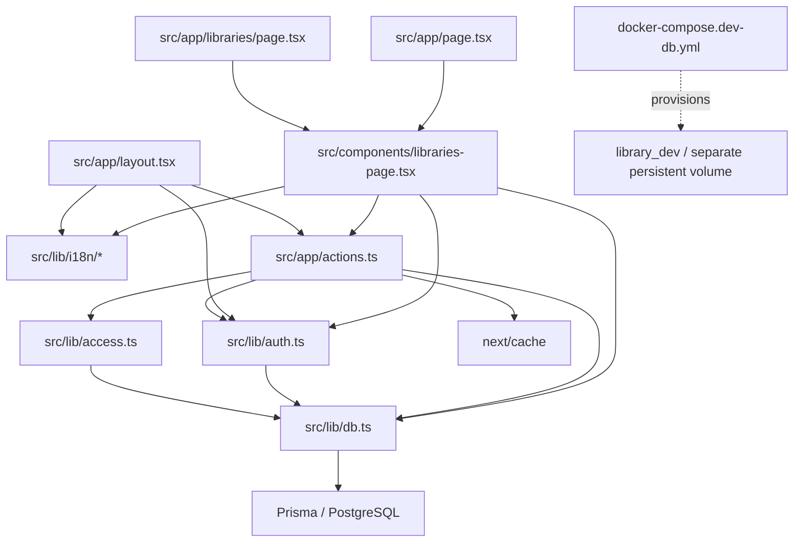

# Brooks-Lint Health Dashboard

- [Brooks-Lint Health Dashboard](#brooks-lint-health-dashboard)
  - [Scope And Verdict](#scope-and-verdict)
  - [Dimension Scores](#dimension-scores)
  - [Module Dependency Graph](#module-dependency-graph)
  - [Test Suite Map](#test-suite-map)
  - [Top Findings](#top-findings)
  - [Verification](#verification)
  - [Recommendation](#recommendation)

## Scope And Verdict

**Mode:** Health Dashboard

**Scope:** All changes on `13-library-list-front-page` relative to its base branch, local `main`, plus the pending development-database setup requested after implementation.

**Composite Score:** 100/100

No actionable code or design defect was found in the reviewed changes. Browser-level acceptance remains unverified because Playwright Chromium is unavailable.

The merge base is `6b55b0786b5e8daaf1567540f4be2ed301a6cc40`. The branch contains one implementation commit, `aa0361b` (`feat: show library list on front page`). `origin/main` is behind local `main`; it is not the task's branch point. The committed review scope is the complete `main...HEAD` diff, not just working-tree changes.

The committed diff contains 13 files: both list routes, the shared page, layout, actions, three new or extended Vitest files, both browser-test files, both package files, and `4-implemented.md`. The two additional pending files reviewed are `docker-compose.dev-db.yml` and `docs/local-development.md`. The ignored local `.env` is runtime configuration, not a proposed tracked change.

No `.brooks-lint.yaml` or health-history file exists. Balanced scoring applies. This score describes findings in this scoped review; it is not proof that all runtime behavior works. The earlier plan score measures a different artifact and is not a comparable trend.

## Dimension Scores

- Code Quality: 100/100. No R1 or R2 finding. Both routes export one implementation, and the extracted page is unchanged from the original library route. Its length is predominantly linear JSX for one view, not mixed responsibilities requiring a split. Navigation and invalidation edits belong to the same feature.
- Architecture: 100/100. No R5 finding in the affected dependency paths. The server page authenticates before querying Prisma, and mutation authorization remains in the existing access boundary. No client component imports the server page, and no new dependency cycle is introduced.
- Tech Debt: 100/100. No actionable R1–R6 finding. The change avoids duplicated list logic and speculative abstractions. Existing DTO-like Prisma records suit this CRUD view. The separate development Compose project has its own database and volume, with an explicit external-network prerequisite and no published database port.
- Test Quality: 100/100. No T1 or T2 finding in changed tests. Names describe behavior, mocks isolate nondeterministic boundaries, and the new browser scenarios separate front-page creation, lifecycle freshness, and sharing. The existing broad registration test gains only the brand-link destination assertion rather than absorbing the new scenarios.

Each dimension starts at 100. With zero scored findings, the composite is `round-half-up(100 × 0.25 + 100 × 0.30 + 100 × 0.25 + 100 × 0.20) = 100`.

## Module Dependency Graph

Arrows show imports or calls in the affected paths. This is a scoped graph, not a whole-repository dependency audit.

`src/components/libraries-page.tsx:11–24` preserves authentication before the owner-or-member query, current-user membership selection, book counts, and descending update order. The unchanged `src/lib/auth.ts:93–120` rejects absent, expired, and disabled user sessions; administrator sessions do not substitute for user sessions.

`src/app/actions.ts:217–247` and `423–462` invalidate the root page and legacy list after successful mutations. Deletion retains authorization, transaction, file cleanup, and redirect ordering. Adding `revalidatePath('/')` does not request root-layout invalidation.

The pending development database uses project `my-library-dev`, database `library_dev`, volume `my-library-dev_postgres`, and alias `library-dev-db`. The documentation distinguishes the container-network path from the existing host-development override and records that browser tests require a disposable database.

## Test Suite Map

- Small/unit and mocked-boundary tests: 31 Vitest files, 131 passing tests. This includes static component rendering, mocked pages/actions/routes, pure logic, and migration-source assertions; these are not real-database integration tests.
- Separate real-database integration tier: None identified. Persisted isolation is assigned to the browser tier.
- E2E: Two Playwright files with nine declared scenarios, discovered as 18 project cases across desktop and mobile. The desktop scanner case is intentionally skipped when executed.
- Changed coverage: Eight shared-page cases, six library-list action cases, and three deletion-cleanup cases. The complete suite also retains the language action regression.
- Browser coverage: New scenarios exercise root URL retention, creation, legacy-list equivalence, rename/delete freshness through client navigation, and separate-user private/viewer visibility. Smoke changes replace the obsolete promotional expectation and check the English brand-link destination.

Exact query assertions test the authorization-relevant database boundary; mocked invalidation assertions test the action boundary. The browser cases exercise different risks and are not redundant copies of those tests. Their existence is not counted as successful runtime verification.

## Top Findings

No Critical, Warning, or Suggestion finding met the evidence and consequence requirements in this scope. The review found no newly introduced structural decay, access-rule change, or actionable test-design defect. The browser execution blocker below is a verification limitation rather than a code-decay finding.

## Verification

- Reran `npm test`: Passed, 131 tests across 31 files.
- Reran `npm run lint`: Passed.
- Reran `npm run typecheck`: Passed.
- Ran `npx --no-install playwright test --list`: Passed, 18 project cases across two files.
- Ran `docker compose -f docker-compose.dev-db.yml config --quiet`: Passed. The existing development database container reports healthy.
- Probed Playwright Chromium launch: Failed because `/home/container/.cache/ms-playwright/chromium_headless_shell-1243/chrome-headless-shell-linux64/chrome-headless-shell` does not exist. No browser assertions executed during this review.
- The production build passed during implementation at the reviewed commit, as recorded in `4-implemented.md`; it was not repeated during this review. The later development setup resolved the historical database-connectivity blocker described in that implementation record.
- Prettier checks on the reviewed code, tests, package files, pending development setup, and this report passed. `git diff --check` passed.

Only this review report is added by the review stage. The pending development setup remains uncommitted. No fixes, environment changes, installations, version changes, or repository-wide history updates were made during this review.

## Recommendation

The reviewed implementation needs no code remediation based on this scan. Install Chromium with `npx playwright install chromium`, provide an isolated disposable test database, and run `npm run test:e2e` before treating browser acceptance as complete. Cache freshness, persisted sharing isolation, and responsive layout still require that runtime evidence. If deeper test assessment is needed afterward, `brooks-test` is the focused follow-up; there is no lower-scoring dimension to prioritize now.
