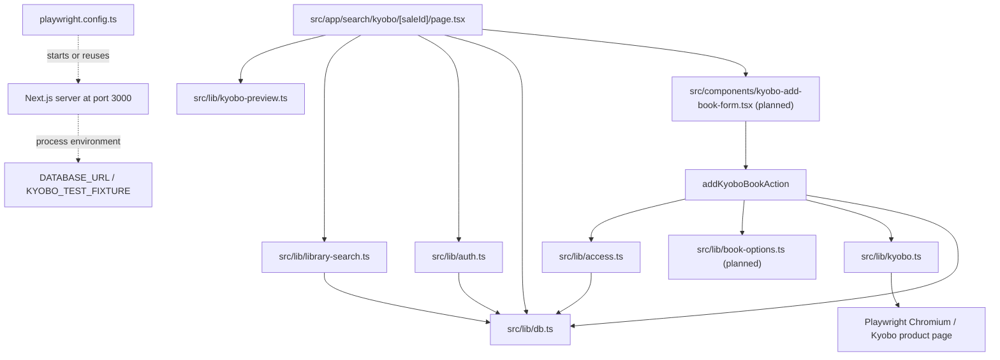

# Brooks-Lint Health Dashboard

- [Brooks-Lint Health Dashboard](#brooks-lint-health-dashboard)
  - [Scope And Verdict](#scope-and-verdict)
  - [Dimension Scores](#dimension-scores)
  - [Module Dependency Graph](#module-dependency-graph)
  - [Test Suite Map](#test-suite-map)
  - [Top Findings](#top-findings)
    - [Warning](#warning)
  - [Recommendation](#recommendation)
  - [Verification](#verification)

## Scope And Verdict

**Mode:** Health Dashboard

**Scope:** Plan review of `tasks/14-kyobo-add-book-options/2-plan.md`, checked against `1-goal.md`, the current Kyobo detail/add flow, option ownership and date rules, and test configuration.

**Composite Score:** 99/100

The plan matches the requested deferred lookup and add-time options. Clarify browser-server isolation before implementation so verification actually uses the intended database and fixtures.

This is a review of a proposed change, not a whole-repository health score or verification of implemented behavior. No `.brooks-lint.yaml` or health-history file exists; balanced scoring applies. There is no implementation diff for this task.

## Dimension Scores

- Code Quality: Not applicable. No task implementation diff exists; assess the proposed design through the remaining dimensions.
- Architecture: 100/100. No R5 finding. The server page owns authenticated destination queries, the client form receives serializable options, and the action retains access and relationship validation before expensive scraping. The proposed pure parser need not import Prisma or browser infrastructure.
- Tech Debt: 100/100. The R1–R6 scan found no actionable plan-level defect. Removing the old progressive-detail machinery follows the changed requirement rather than adding another competing retrieval path. Keeping stricter add-input validation local avoids an unrelated editor/manual-add refactor; the plan explicitly preserves the shared domain behavior that matters.
- Test Quality: 95/100. One T1 Warning: the verification requirement assumes a fresh configured test server, but the existing runner may reuse an unrelated development server.

Balanced scoring deducts 5 for the Warning. With Code Quality omitted, the composite is `round-half-up((100 × 0.30 + 100 × 0.25 + 95 × 0.20) / 0.75) = 99`. Count the finding only in Test Quality. No prior implementation-review score is directly comparable to this plan review.

## Module Dependency Graph

Solid arrows show proposed imports or calls; dashed arrows show test orchestration. Planned modules do not exist yet. This graph covers the affected design, not every repository dependency.

The key boundary is preserved: the review route no longer depends on the full metadata resolver, while submission invokes it after authorization. Current `addKyoboBookAction` already resolves canonical metadata on add (`src/app/actions.ts:614–665`); the plan correctly removes the redundant opening-time lookup instead of trusting preview fields for persistence.

The existing destination query permits only owners and editors (`src/lib/library-search.ts:57–67`). The plan correctly scopes locations to the destination owner and folders to the destination library, matching the editor checks in `src/app/actions.ts:763–786`. Initial placement remains part of creation rather than a synthetic move event.

## Test Suite Map

- Current small-test tier: 31 Vitest files covering components, pure helpers, mocked server pages/actions/routes, and migration-source assertions. These mocked database boundaries are not real-database integration tests.
- Current separate real-database integration tier: None identified in the inspected test layout. Persisted browser scenarios supply the real database checks relevant to this task.
- Current browser tier: Two files, `e2e/smoke.spec.ts` and `e2e/libraries.spec.ts`, with nine declared scenarios across desktop and mobile projects. The existing scanner case is mobile-only.
- Planned small tests: Replace the obsolete progressive-detail page cases, add focused form and parser suites, and extend or extract action tests. Coverage includes unauthorized submissions before scraping, canonical metadata precedence, cross-owner/cross-library IDs, ISBN placement, date defaults, duplicates, and cleanup failures.
- Planned browser changes: Replace the progressive-detail scenario with deferred-add success/failure/retry behavior and add a separate destination-switch scenario. Tests use fixtures rather than live Kyobo access and include English and mobile states.

The planned tests check distinct boundaries rather than duplicating one scenario at every layer. Frozen time for date-default cases, small setup helpers, and separate browser scenarios reduce brittleness. The remaining concern is the test server's external state, described below.

## Top Findings

### Warning

**T1: Test Obscurity — Reused development server can bypass the test database and fixture environment**

- Symptom: `2-plan.md:64–73` requires deterministic Kyobo fixtures and an isolated disposable PostgreSQL database, explicitly excluding seeded `library_dev`. However, `playwright.config.ts:7–13` targets port 3000 and sets `reuseExistingServer: true`. Its `webServer.env` applies only when Playwright launches a server; the plan does not specify how to prevent reuse of an already-running `npm run dev` process. That process can retain the normal development database and omit `KYOBO_TEST_FIXTURE=1`.
- Source: *xUnit Test Patterns* — Mystery Guest; *The Art of Unit Testing* — Test isolation.
- Consequence: Setting a test `DATABASE_URL` for the runner does not guarantee the server uses it. Browser scenarios can create records in `library_dev`, miss their deterministic fixture, or contact live Kyobo depending on whether a development server was running. The same command can therefore fail for unrelated reasons or verify a different environment from the one recorded.
- Remedy: Amend Step 6 to require a Playwright-owned test server with explicitly selected disposable database and fixture settings. Use a dedicated port with server reuse disabled, or an equivalent configuration that refuses an occupied test port instead of silently reusing it. Keep `baseURL` and the readiness URL aligned with that port, pass both environment values to the spawned server, and document the invocation. Also state how any failure/retry fixture state is isolated across desktop/mobile cases and retries, rather than relying on the current shared fixture product ID and test order.

## Recommendation

Keep the proposed fetch boundary, server-side option validation, destination scoping, canonical format policy, localized inline feedback, and transaction/cleanup behavior. Update the verification step to make server ownership and environment selection explicit; this is the only scored finding. Test Quality is the dimension to revisit with `brooks-test` after the changed suites exist and can run.

The plan already addresses the main change risks: preview-free direct links, immutable saved title/authors, invalid options rejected before scraping, defaulted-date ordering, foreign location/folder IDs, ebook location clearing, duplicate preservation, and failed-save cover cleanup. Its decision to preserve existing concurrent-duplicate limitations without an unplanned migration is proportionate to this task.

## Verification

This was a static plan review. Current routes, actions, query helpers, preview validation, Kyobo fixture/scraper behavior, and representative test patterns were read to validate the proposal. Application tests, builds, and browser scenarios were not run because this stage does not implement the plan.

Prettier and `git diff --check` passed for this review document. Only `3-plan-review.md` is written by this stage; no implementation code, `2-plan.md`, `todo.md`, version, environment, or repository-wide health-history file is changed.
