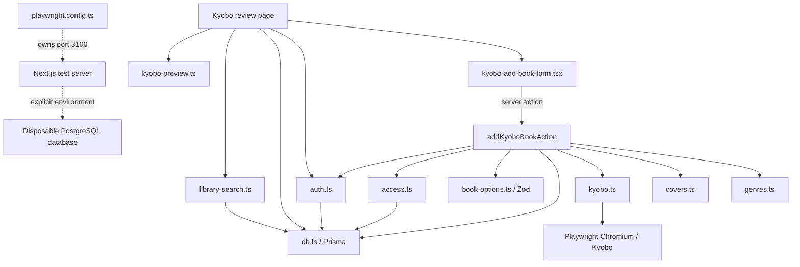

# Brooks-Lint Health Dashboard

- [Brooks-Lint Health Dashboard](#brooks-lint-health-dashboard)
  - [Scope And Verdict](#scope-and-verdict)
  - [Dimension Scores](#dimension-scores)
  - [Module Dependency Graph](#module-dependency-graph)
  - [Test Suite Map](#test-suite-map)
  - [Top Findings](#top-findings)
    - [Warning](#warning)
  - [Verification](#verification)
  - [Recommendation](#recommendation)

## Scope And Verdict

**Mode:** Health Dashboard

**Scope:** All 21 changed files on `14-kyobo-add-book-options` relative to local `main`, covering both implementation and browser-verification commits.

**Composite Score:** 99/100

No critical defect was found. The deferred lookup and option flow have passing functional coverage; one warning concerns lost diagnostic information on unexpected failures.

The merge base is `e5ffa96d301fc332c5184173bb55a6dc35a2d207`. Both `253cc6e` (`feat: defer Kyobo lookup and add book options`) and `5ce23da` (`fix: stabilize Kyobo browser verification`) are included. The review uses `main...HEAD`, not just the latest commit or working-tree diff. The working tree was clean when review began.

The scope includes the review page, add form, option parser, server action, translations, fixture behavior, changed unit/browser tests, Playwright/Next.js/type configuration, verification documentation, package versions, and implementation record. No `.brooks-lint.yaml`, health-history file, or `AGENTS.md` was found. Balanced scoring applies. This is a change-scoped score, not a whole-repository audit or a comparison with the earlier plan score.

## Dimension Scores

- Code Quality: 95/100. One R1 Warning for discarding unexpected error causes in the add action. No separate R2 issue was found: the coordinated page, form, action, and test changes belong to one feature.
- Architecture: 100/100. No R5 finding in affected paths. The review page no longer calls the full metadata resolver. Authentication, destination/relationship checks, canonical retrieval, and persistence stay server-side; the client receives serialized options and invokes a Next.js server-action reference.
- Tech Debt: 100/100. The R1–R6 scan found no additional actionable issue. The pure parser has a concrete consumer, obsolete progressive-detail logic was removed, and manual/edit workflows were not needlessly refactored. The diagnostic finding is counted only in Code Quality.
- Test Quality: 100/100. No T1 or T2 finding remains in changed tests. Separate form, parser, action, page, and persisted browser checks exercise distinct boundaries. Dedicated server settings and fixture identities resolve the environment and data collisions exposed during retesting.

Balanced scoring deducts 5 for the Warning. The composite is `round-half-up(95 × 0.25 + 100 × 0.30 + 100 × 0.25 + 100 × 0.20) = 99`. No finding is deducted in more than one dimension.

## Module Dependency Graph

Arrows show imports or calls in the changed paths. The client-to-action edge is a Next.js server-action reference; it does not bundle the database or scraper into the browser.

The metadata resolver is absent from review-page imports and execution. Authorized destination IDs bound the option query (`src/app/search/kyobo/[saleId]/page.tsx:49–75`). The action checks destination write access and tag/folder relationships before canonical retrieval (`src/app/actions.ts:614–657`), ignores submitted bibliographic metadata, clears ebook location, and writes options with metadata in one transaction (`679–712`). High fan-out here is expected orchestration rather than a dependency inversion.

The parser imports Zod without Prisma, Next.js, or Playwright dependencies. The form imports its result type only. Existing data records are appropriate for this CRUD workflow; there is no need for a richer domain hierarchy merely to enforce these input rules.

## Test Suite Map

- Small/unit and mocked-boundary tier: 34 Vitest files, 173 passing cases from the final verification run. These cover pure rules, rendered components, and mocked server/database boundaries; they are not real-database integration tests.
- Separate database-integration tier: None identified. Persisted behavior relevant to this change is exercised by the browser tier.
- Browser tier: Three files with 11 declared scenarios, producing 22 project cases. The final full run passed 21, with one expected desktop skip for the mobile-only scanner scenario.
- New focused coverage: 19 parser cases, five form cases, seven review-page cases, and 17 action-option cases. Existing add-action cases were updated to assert inline failures and canonical success behavior.
- Persisted browser checks: Add-time metadata/options, failure without a saved book, retry retaining choices, destination resets, shared-owner locations/folders, and saved read-only title/authors. The existing library, settings, upload, scanner, and folder scenarios also passed.

Frozen-time date tests avoid wall-clock dependence. Controlled form values and reset prevention are tested through a recoverable result and retry. Unique failure-fixture IDs separate scenarios/projects/retries, while the dedicated genre URL avoids shared-catalog collisions. Query/persistence assertions are justified boundary checks; the browser tier verifies the separate real-data and navigation risks.

## Top Findings

### Warning

**R1: Cognitive Overload — Recoverable responses erase the causes of unexpected add failures**

- Symptom: New catch blocks discard the exception from destination-option queries (`src/app/actions.ts:650–652`), canonical retrieval/URL validation (`656–658`), and the duplicate/create/audit transaction path (`713–715`). They return only `saveFailed` or `detailsUnavailable`, with no server-side diagnostic record. The access catch at `625–627` also maps any thrown database failure inside `requireLibraryAccess()` to `accessDenied`. Unlike the previous rethrow, these paths no longer let Next.js retain the underlying failure in its normal exception handling.
- Source: _Code Complete_ — Defensive Programming and error-handling discipline.
- Consequence: A Kyobo markup change, missing browser runtime, failed database query, genre conflict, or transaction error produces nearly the same user-facing symptom without its original cause or stage. Maintainers cannot distinguish those failures from the returned code and must reproduce the operation to recover the missing evidence. Functional failure-path tests can pass while production diagnosis becomes substantially harder.
- Remedy: Keep the typed, localized responses and input-retention behavior, but record unexpected technical exceptions server-side with the original error, operation stage, product ID, and destination ID. Reuse the existing `console.error` convention rather than adding a logging subsystem. Distinguish expected access rejection from unexpected dependency failure where needed, and keep raw diagnostics out of the UI. Extend the relevant failure-path tests to verify that the returned error code and an actionable internal diagnostic are both preserved without asserting exact stack/message formatting.

No Critical finding was identified. Expected validation results, duplicate feedback, and the pre-existing best-effort cover fallback are not additional findings.

## Verification

- During this review, reran `npx --no-install vitest run src/app/actions-kyobo-options.test.ts`: 17 cases passed. This confirms the reviewed success/failure behavior; it does not resolve the diagnostic finding.
- The immediately preceding verification of the code now committed in `5ce23da` passed all 173 Vitest cases, lint, typecheck, formatting, and diff checks. The full isolated browser run passed 21 cases with the expected scanner skip, following six passing targeted Kyobo project cases. These results were observed in this session and are recorded in `4-implemented.md`; the full suites were not needlessly repeated for this documentation-only review.
- The production build passed during implementation. Later changes were test-harness, fixture, test, and result-record corrections; no live Kyobo scrape was part of browser verification.
- Reviewed the complete two-commit diff, current affected modules, existing access/genre conventions, and verification setup. Package and lockfile root versions consistently read `0.7.5`, with no dependency or schema migration change.
- Prettier and `git diff --check` passed for this review report. Only `5-code-review.md` is added in this stage; implementation code, environment configuration, task plan/results, version, and `todo.md` are unchanged. No repository-wide health-history file is written for this task-scoped report.

## Recommendation

Preserve the implemented architecture and functional behavior. Address the single error-diagnostics warning as a focused follow-up, then rerun the action failure cases. Code Quality is the only dimension with a deduction; a focused `brooks-review` of that small follow-up is sufficient. There is no evidence here requiring another broad refactor or test-suite redesign.
