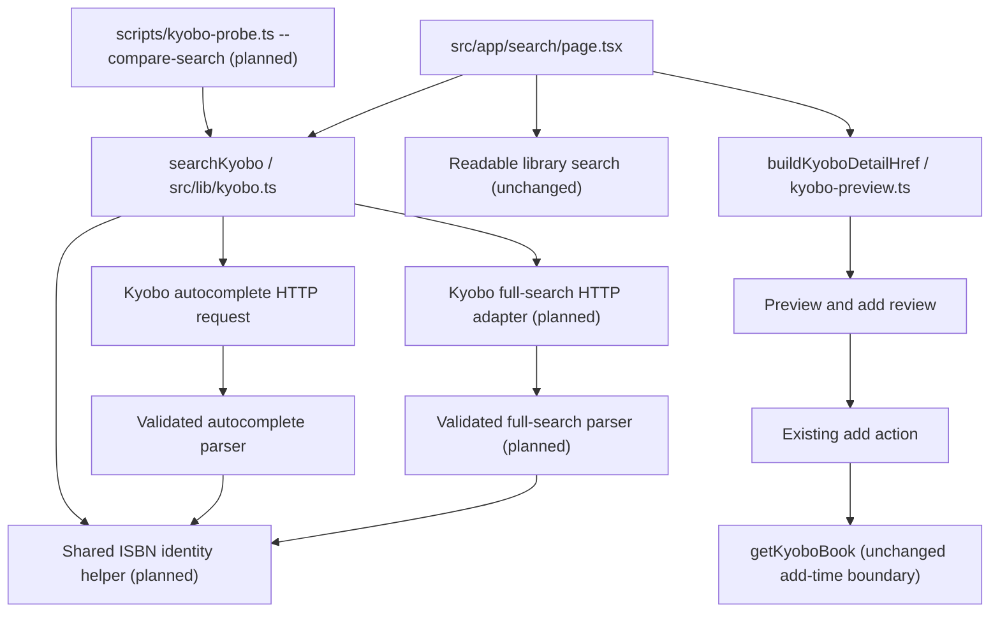

# Brooks-Lint Health Dashboard

- [Brooks-Lint Health Dashboard](#brooks-lint-health-dashboard)
  - [Scope And Verdict](#scope-and-verdict)
  - [Dimension Scores](#dimension-scores)
  - [Module Dependency Graph](#module-dependency-graph)
  - [Test Suite Map](#test-suite-map)
  - [Top Findings](#top-findings)
    - [Warning](#warning)
  - [Recommendation](#recommendation)
  - [Verification](#verification)

## Scope And Verdict

**Mode:** Health Dashboard

**Scope:** Plan review of `tasks/15-reliable-barcode-search/2-plan.md`, checked against the clarified goal, current Kyobo transport/parser/filter behavior, preview navigation, diagnostic script, and test setup.

**Composite Score:** 98/100

The plan correctly isolates search from scanning and protects result identity. Add an explicit evidence gate before committing to a second upstream adapter.

No implementation diff exists for task 15. This score assesses the proposed change and verification design, not completed behavior or whole-repository health. No `.brooks-lint.yaml` or health-history file was found; balanced scoring applies. Scores from earlier tasks or implementation reviews are not a comparable trend.

## Dimension Scores

- Code Quality: Not applicable. There is no implementation diff for this task.
- Architecture: 100/100. No R5 finding. Search orchestration and response parsing remain behind the existing provider contract; the page consumes validated candidates rather than provider-specific markup. The probe is intended to reuse provider helpers, and neither search nor preview calls the full-product resolver.
- Tech Debt: 95/100. One R4 Warning: the plan requires an additional full-search adapter before evidence establishes that an upstream coverage gap needs it. No additional actionable R1–R6 issue was found.
- Test Quality: 100/100. No T1 or T2 finding in the proposed coverage. The plan separates captured-response parsing, mocked transport orchestration, page rendering, offline browser flows, and explicit live comparison. It preserves the dedicated test server and disposable database conventions.

Balanced scoring deducts 5 for the Warning. With Code Quality omitted, the composite is `round-half-up((100 × 0.30 + 95 × 0.25 + 100 × 0.20) / 0.75) = 98`. The finding is counted only in Tech Debt.

## Module Dependency Graph

Arrows show the proposed affected calls/imports. The full-search source is planned, not implemented. This is a scoped design graph, not a whole-repository cycle analysis.

The current transport sends a trimmed query to autocomplete (`src/lib/kyobo.ts:236–266`). Candidate mapping normalizes response ISBNs, discards missing required identities, and final filtering compares the ISBN string exactly (`110–179`). The plan identifies each stage as an investigation target rather than declaring it defective without a reproduction.

Keeping the provider's candidate-array contract avoids propagating upstream schemas into the page. ISBN equivalence must stay narrow, with `978` conversion validated and `979` treated separately. Updating related preview validation when needed is normal coordinated change inside one search flow, not Shotgun Surgery.

## Test Suite Map

- Current small-test tier: 34 Vitest files covering pure helpers, component rendering, and mocked page/action/database boundaries. The existing Kyobo tests cover known autocomplete JSON, optional metadata, malformed documents, deduplication, exact ISBN filtering, product parsing, and deferred-add fixtures.
- Current separate real-database integration tier: None identified in the test layout. Database persistence relevant to the application is exercised in browser scenarios rather than a standalone integration suite.
- Current browser tier: Three Playwright files with 11 declared scenarios across desktop/mobile projects, yielding 22 project cases. The desktop scanner case is intentionally skipped; the scanner itself is outside this task's scope.
- Planned additions: Captured mismatch fixtures, pure full-search parsing where justified, mocked request-level orchestration, ISBN identity/preview cases, a new async search-page test file, and an offline browser scenario that starts with a decoded ISBN.
- Planned external verification: Explicit fixture-disabled comparison with a reported failing ISBN, a working control, and a no-match query. Live Kyobo access is kept outside CI, and the diagnostic comparison avoids full-product scraping.

Mocked transport tests protect fallback selection and request bounds; they do not prove live catalog coverage. The plan correctly requires live reproduction evidence in addition to synthetic success. Preserving unique fixture IDs, loopback origin settings, disabled server reuse, and an explicit disposable test database addresses the existing suite's known environment risks.

## Top Findings

### Warning

**R4: Accidental Complexity — Full-search fallback is mandatory before its necessity is established**

- Symptom: `2-plan.md:22–24` leaves the root cause open, and `80–81` records that the only planning-time control worked through both autocomplete and the website. Nevertheless, Step 3 (`36–44`) unconditionally requires a second transport/parser, Step 5 requires fallback-specific fixtures, and acceptance criterion `73` requires fallback recovery. There is no explicit decision path for completing the task with only a proven normalization or response-mapping fix when that resolves the reported mismatch.
- Source: _Code Complete_ — Design in Construction and YAGNI; _A Philosophy of Software Design_ — Strategic versus Tactical Programming.
- Consequence: An implementer can satisfy the user's actual failure with a small correction yet still be required to ship an HTML/backing-response integration. That adds another changing external contract, another failure taxonomy, and up to a second eight-second request to maintain. A fallback may also mask an existing parser defect rather than resolving the stage that lost the reported match.
- Remedy: Add a decision gate immediately after reproduction. If normalization, identity matching, or an observed schema correction restores the website-confirmed result through autocomplete, implement that correction and its end-to-end regression without automatically adding fallback. Require the full-search adapter only when a captured case demonstrates that autocomplete genuinely lacks the valid result or cannot provide a usable response while full search can. Make fallback-specific tests and acceptance criteria conditional on that evidence, and record the chosen path and reproduction in `4-implemented.md`. If no mismatch can be reproduced, record the missing evidence and request a failing ISBN rather than declaring either a root cause or a resolved external defect.

No Critical finding was identified. The warning does not reject a bounded fallback when a demonstrated coverage gap justifies it; the plan already gives that design appropriate identity, timeout, and error-handling safeguards.

## Recommendation

Keep the search-only scope, normalized transport parameters, shared identity rules, preserved candidate contract, explicit error/no-match distinction, and layered verification. Tighten the reproduction-to-remedy decision before implementation so the task can take the smallest evidence-backed path. Tech Debt is the only dimension with a deduction; a focused `brooks-review` of the chosen implementation would be the appropriate follow-up.

The reported failure is still not tied to a concrete failing ISBN. This limits confidence in any proposed remedy but does not prevent source-level analysis or planning. The document appropriately excludes scanner changes and does not treat a working control or fixture as proof that the user's failure is fixed.

## Verification

This was a static review of the latest goal and plan against current provider, page, preview, diagnostic, and test boundaries. No application tests, builds, live searches, or browser suites were run during this review. The successful planning-time control lookup is evidence recorded in the plan, not a newly reproduced failure or a new review-time verification run.

Prettier and `git diff --check` passed for this report. Only `3-plan-review.md` is written by this stage. No implementation code, `2-plan.md`, version, environment, `todo.md`, or repository-wide health-history file is changed.
