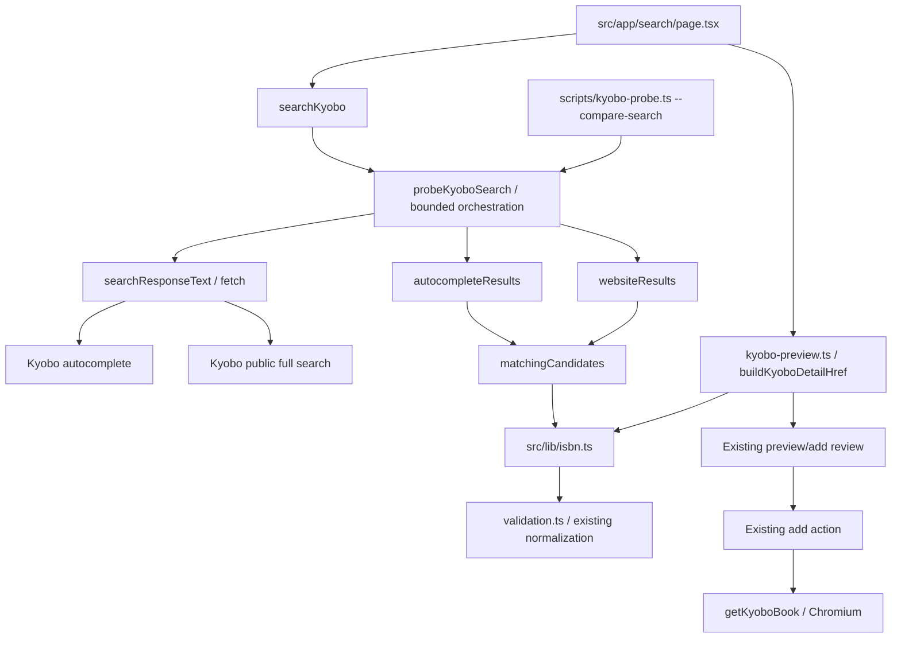

# Brooks-Lint Health Dashboard

- [Brooks-Lint Health Dashboard](#brooks-lint-health-dashboard)
  - [Scope And Verdict](#scope-and-verdict)
  - [Dimension Scores](#dimension-scores)
  - [Module Dependency Graph](#module-dependency-graph)
  - [Test Suite Map](#test-suite-map)
  - [Top Findings](#top-findings)
    - [Warning](#warning)
  - [Verification](#verification)
  - [Recommendation](#recommendation)

## Scope And Verdict

**Mode:** Health Dashboard

**Scope:** All 15 changed files on `15-reliable-barcode-search` relative to local `main`, including provider behavior, ISBN matching, preview validation, diagnostics, tests, documentation, version metadata, and the implementation record.

**Composite Score:** 99/100

The implementation resolves the reproduced autocomplete coverage gaps and has passing verification. One correctness warning remains: a partial website result page can be misclassified as a confirmed no-match outcome.

The merge base is `2a54cf25e4a83db2daec91525b924339450d6cc9`. The complete branch diff contains one implementation commit, `b6f2985` (`fix: recover missing Kyobo ISBN search results`). Review uses `main...HEAD`, not only working-tree changes. The working tree was clean when review began. No `.brooks-lint.yaml` or health-history file was found; balanced scoring applies. This score is change-scoped and is not a comparison with the earlier plan review.

## Dimension Scores

- Code Quality: 100/100. No separate R1 or R2 finding. Request normalization, pure parsing, identity matching, bounded reads, and orchestration have distinct helpers. Coordinated edits to preview validation and search tests support one feature rather than unrelated change propagation.
- Architecture: 100/100. No R5 finding in affected paths. The page consumes provider candidates, website markup remains inside the provider, shared ISBN rules have no network/framework dependency, and the CLI reuses the same orchestration. Search/review do not call the add-time full-product resolver.
- Tech Debt: 95/100. One R6 Warning: incomplete evidence is represented by an empty candidate array, which the UI interprets as no matching books. No additional actionable R1–R6 issue was found; the reproduced coverage gap justifies the new fallback and resolves the earlier speculative-complexity concern.
- Test Quality: 100/100. No T1 or T2 finding in changed suites. Captured upstream records, pure identity checks, real response streams under mocked transport, page states, and browser navigation exercise distinct risks. The missing partial-page case is addressed in the single finding rather than deducted again.

Balanced scoring deducts 5 for the Warning. The composite is `round-half-up(100 × 0.25 + 100 × 0.30 + 95 × 0.25 + 100 × 0.20) = 99`. Count the finding only in Tech Debt.

## Module Dependency Graph

Arrows show imports or calls in the affected paths. The full-detail edge is shown to distinguish its unchanged add-time role from search transport.

No runtime cycle appears in these affected dependencies. The provider retains `BookCandidate[]` as its public search result, while the comparison report exposes source/count/error information to the diagnostic script. Reusing ISBN identity in both search and preview prevents those boundaries from accepting different ISBN-10 `X` shapes. Existing exact-match compatibility and validated `978` equivalence remain distinct policies.

The fallback is evidence-backed: the implementation record documents eight ISBNs with empty autocomplete responses and website product matches. The adapter uses actual card identity attributes, verifies product links, and does not infer a candidate ISBN from the query. It keeps one-request success/keyword paths and a bounded second request for ISBN recovery.

## Test Suite Map

- Small/unit and mocked-boundary tier: 37 Vitest files, 231 passing cases from implementation verification. These include helper rules, rendered components, mocked pages/actions/database boundaries, and provider transport tests; they are not a standalone real-database integration suite.
- Separate database-integration tier: None identified. Relevant persisted application behavior is covered by the browser tier.
- Browser tier: Four files with 12 declared scenarios, producing 24 desktop/mobile cases. Final implementation verification passed 23, with the expected desktop skip for the mobile-only scanner layout case.
- Added focused coverage: 18 ISBN cases, 34 website-parser/transport cases, five search-page cases, one additional preview round trip, and one decoded-ISBN browser scenario per project.
- Existing compatibility evidence: Canonical add-time metadata/options, retry input retention, shared-owner choices, library authorization/navigation, scanner layout, uploads, and folders passed in the full browser suite.

The test fixture substitutes upstream response bodies behind both nonproduction and explicit fixture guards, so the new browser case exercises actual parsing and fallback selection. Streaming limit tests use `ReadableStream` cancellation rather than only checking a numeric constant. Live comparisons are kept outside ordinary tests. Current cases cover complete empty/nonmatching responses and wholly missing/malformed result data, but not a valid first page whose advertised total exceeds its card count.

## Top Findings

### Warning

**R6: Domain Model Distortion — An incomplete page is treated as confirmed absence**

- Symptom: `websiteResults()` reads `data-total-count`, but its validation only rejects positive totals with zero cards, rejected identities without a match, or zero totals with cards (`src/lib/kyobo.ts:199–255`). It does not reject an incomplete result set when the total is greater than the number of inspected cards and none matches. `probeKyoboSearch()` then returns that empty array as successful website confirmation (`369–375`), and the search page renders `noKyoboBooks`. A read-only counterexample with 21 advertised products and 20 valid nonmatching cards returned `[]`. The implementation-time live lookup for `9799999999999` also showed that the website can advertise 21 products while returning 20 cards; that observation establishes pagination, not that a matching book exists on the omitted page.
- Source: _Domain-Driven Design_ — Ubiquitous Language and faithful domain outcomes; _Code Complete_ — Defensive Programming and explicit handling of incomplete inputs.
- Consequence: When autocomplete misses and the requested ISBN is only on an uninspected website page, the app can show a definitive no-result message despite the website having that book. Even without knowing the omitted product's identity, the first page alone cannot establish absence. This conflates “not found in the inspected subset” with “no matching book,” recreating the failure class the task is meant to prevent.
- Remedy: Preserve the bounded two-request policy, but treat a no-match website page with an advertised total greater than its inspected result count as incomplete evidence. Return a contextual failure through the existing unavailable path rather than a successful empty array; include total/inspected counts in diagnostics. A verified match may still be returned from a partial page. Add parser, orchestration, and page-state regressions for partial/no-match versus complete/no-match and partial/verified-match behavior. This does not require automatic pagination or extra requests.

No Critical finding was identified. This warning does not invalidate the eight recovered live cases, each of which contained a verified matching result on the fetched page. The bounded-pagination decision is proportionate; its empty-result classification needs tightening.

## Verification

- During this review, ran `npx --no-install vitest run src/lib/kyobo-search.test.ts src/lib/isbn.test.ts`: 52 cases passed.
- Executed a read-only `tsx` counterexample against `parseWebsiteSearchResponse()`: requested ISBN `9780201633610`, advertised total 21, 20 valid cards for another ISBN, returned result `[]`. No implementation or test file was changed to demonstrate it.
- The immediately preceding implementation verification, observed in this session and recorded in `4-implemented.md`, passed all 231 unit cases, lint, typecheck, production build, formatting, and diff checks, plus 23 browser cases with one expected skip. Live fixture-disabled comparisons recovered eight misses and preserved the autocomplete control; formatted and ISBN-10 variants also found the expected identity. Those broad runs were not repeated for a documentation-only review.
- Read the complete branch diff and affected current provider, identity, preview, diagnostic, page, test, fixture, documentation, and version boundaries. Root versions consistently read `0.7.6`, without dependency or schema migration changes.
- Prettier and `git diff --check` passed for this review report. Only `5-code-review.md` is added in this stage. No fixes, environment changes, version updates, task-plan/result edits, or changes to `todo.md` were made. No repository-wide health-history file is written for this task-scoped report.

## Recommendation

Fix the partial-page empty-result classification before treating all no-match outcomes as verified. Keep the demonstrated fallback, identity safeguards, request bounds, and deferred-metadata boundary. Tech Debt is the only dimension with a deduction; a focused follow-up review of that outcome guard and its regressions is sufficient, without another broad redesign.
