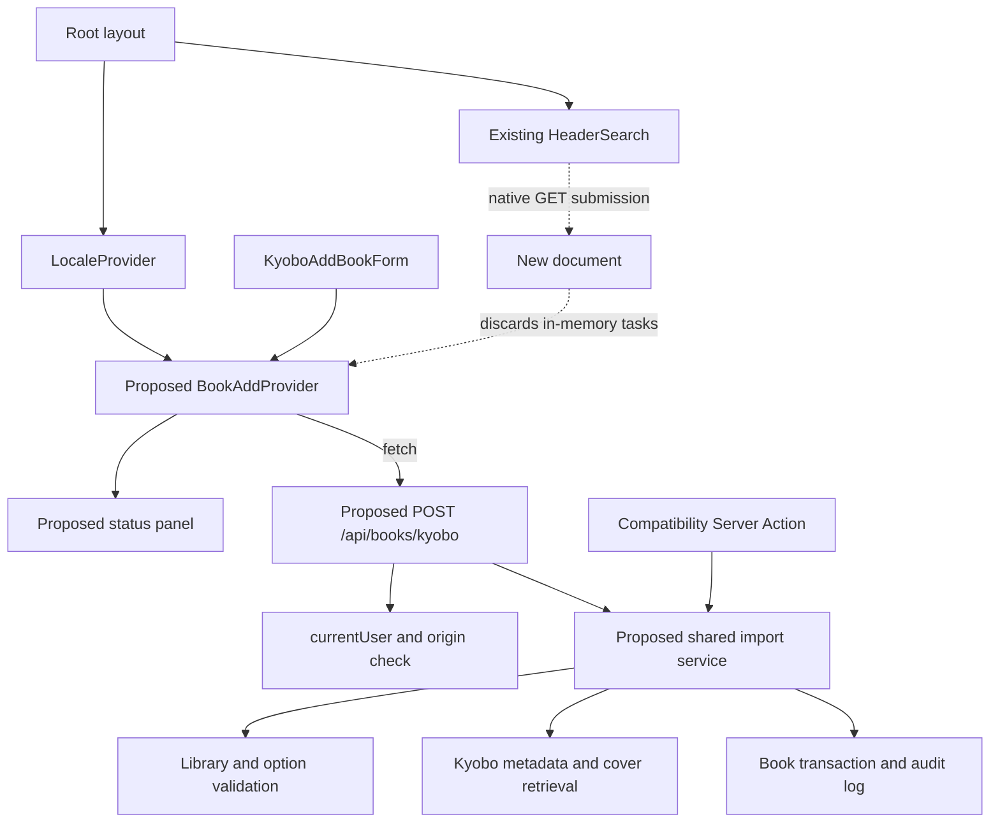

# Brooks-Lint Health Dashboard

- [Review Basis](#review-basis)
- [Dimension Scores](#dimension-scores)
- [Module Dependency Graph](#module-dependency-graph)
- [Test Suite Map](#test-suite-map)
- [Top Findings](#top-findings)
  - [Warning](#warning)
- [Recommendation](#recommendation)

**Mode:** Health Dashboard

**Scope:** Static review of `tasks/16-background-book-add/2-plan.md` against its goal and the existing Kyobo import, shared layout, search navigation, and test seams. Scores describe the proposed plan, not implemented behavior or whole-project health.

**Composite Score:** 95/100

**Trend:** First plan-scoped run; no prior comparable history.

**Verdict:** Revise before implementation. The basic provider-and-endpoint design is sound, but ordinary search must preserve its lifetime, uncertain saves need a complete recovery contract, and browser tests must prove work remains pending.

## Review Basis

Applied the four Brooks health dimensions with balanced deductions. No `.brooks-lint.yaml` exists, so defaults apply. The existing unrelated `next-env.d.ts` change is outside this review. No implementation files or plan text were changed, and no runtime tests were executed.

The review checked R1–R6 and the proposed test strategy against T1–T6. Findings below are design gaps supported by current code, not claims that proposed modules already contain defects. The service extraction preserves a useful boundary: adapters handle authentication, navigation, and HTTP responses while one import service owns validation and persistence. In-memory tasks, explicit retries, and indeterminate progress are proportionate to the stated open-tab scope; durable jobs and database-wide exactly-once delivery are not prerequisites.

## Dimension Scores

- Code Quality: Not scored because there is no in-scope implementation diff. The unrelated working-tree change does not activate this dimension.
- Architecture: 95/100. One Warning: the proposed state lifetime conflicts with existing native search submission.
- Tech Debt: 95/100. One Warning: an uncertain save can become a persistent duplicate error without a resolution path.
- Test Quality: 95/100. One Warning: delaying a response alone can hide whether the import was still running during navigation.

Each scored dimension starts at 100 and loses 5 for its single Warning. With Code Quality omitted, weights redistribute as `0.30 / 0.75`, `0.25 / 0.75`, and `0.20 / 0.75`; the weighted composite is 95. There are zero Critical findings, three Warnings, and zero Suggestions. A high numerical score does not resolve these acceptance-critical gaps.

## Module Dependency Graph

The graph combines proposed dependencies with the existing navigation path that threatens provider lifetime. Dashed arrows describe lifecycle effects rather than imports.

No dependency cycle is required by the proposal. Type-only client imports must stay separate from the server-only service. Thin route and action adapters are justified because their transport and navigation behavior differs.

## Test Suite Map

The current repository has 37 colocated Vitest test files under `src/`, including 2 API route test files, plus 4 Playwright spec files under `e2e/`. These are file counts, not executed case counts; Vitest files include component, service, action, route, and page tests rather than a strict unit-only suite.

The plan sensibly moves import assertions toward the shared service, retains compatibility-wrapper behavior, uses deferred responses for provider tests, and keeps browser coverage for saved options and real navigation. Existing `e2e/kyobo-options.spec.ts:96-126` checks both absence after failure and persisted metadata after retry. Retain that real persistence protection when replacing redirect assertions; a mocked success response cannot establish that a book was saved.

## Top Findings

### Warning

**1. R5 — Architecture: Native header search destroys the proposed background state.**

- **Symptom:** `2-plan.md:15` promises users can search while additions run, but steps 3–4 only preserve state across client-side navigation. `src/components/header-search.tsx:42-47` uses a native `<form action="/search">` with no submission interception. Unlike the scanner's `router.push` at lines 30–37, a normal search submits a new document. The plan neither changes this entry point nor tests it.
- **Source:** *The Mythical Man-Month* — Conceptual Integrity; *Clean Architecture* — consistent responsibility and lifecycle boundaries.
- **Consequence:** The most direct way to search for the next book discards the task provider and progress display. The server may still save the first book, but the user loses its outcome and retry context. This contradicts the main workflow even within an open tab.
- **Remedy:** Explicitly include `src/components/header-search.tsx` and its tests in the plan. Use Next.js client-side GET navigation, through `next/form` or a prevented submit with `router.push`, preserving query/source semantics and scanner behavior. Inspect the search and library GET forms reachable during this workflow for the same lifecycle break. Add an acceptance test that submits the actual header search during a pending add, confirms the provider survives, and verifies the result appears on the search page. Do not redefine ordinary app search as an excluded reload.

**2. R6 — Tech Debt: Unknown outcomes have no terminal reconciliation path.**

- **Symptom:** `2-plan.md:42` correctly distinguishes network loss and permits explicit retry, while `2-plan.md:50` promises actionable failures. However, `src/app/actions.ts:661-675` currently returns only `{ error: 'alreadyExists' }` when the same book is found. If a save commits but its response is lost, retry produces that error without the existing book ID. The plan does not say how the task leaves its uncertain/error state or how the user reaches the saved book.
- **Source:** *Domain-Driven Design* — Ubiquitous Language and faithful lifecycle modeling; *Code Complete* — explicit error-handling paths.
- **Consequence:** A completed import can appear to fail repeatedly. Retrying cannot apply corrected options to an already-created book, and the user cannot distinguish a completed first attempt from a genuinely conflicting earlier copy through the task UI.
- **Remedy:** Define an explicit existing-book outcome for the endpoint, including an authorized `bookId` and `libraryId` from the existing duplicate query. Show “already in library” with a view/edit link, stop the retry loop, and never claim the retried options were applied. Preserve the compatibility action's current error shape through its adapter. Add a test that commits the first request, loses its response, retries explicitly, and resolves to the existing book without another row. This requires neither a durable job queue nor a new uniqueness guarantee.

**3. T5 — Test Quality: A held response can pass after the import has already finished.**

- **Symptom:** `2-plan.md:59-60` proposes holding the add response while navigating, with fixture changes only if interception is insufficient. A test that calls `route.fetch()` and then delays fulfillment can complete the database write before navigation. A synthetic successful response can avoid the import entirely. Neither proves the user can act while add-time work is actually pending.
- **Source:** *How Google Tests Software* — Change Coverage; *xUnit Test Patterns* — test fixtures that expose the behavior being claimed.
- **Consequence:** Browser tests could validate only delayed notification rendering while missing an import/navigation coupling regression. Mocked JSON could also conceal a broken endpoint-to-persistence path despite passing provider tests.
- **Remedy:** Specify two distinct checks. Use deferred mocked fetches for provider lifecycle and out-of-order state tests. For the browser workflow, gate the actual request before forwarding it to the real endpoint, or use a guarded fixture that pauses metadata retrieval; submit the header search or another real action while that gate is closed, then release it and assert both the visible result and persisted book. Use explicit gate synchronization rather than timing-only sleeps, and release gates in cleanup. Keep the real option-persistence scenario in `e2e/kyobo-options.spec.ts`.

## Recommendation

Update the plan first with client-side header-search submission and its browser acceptance case. Then define existing-book reconciliation for uncertain outcomes and make the test gate prove pending work rather than merely a pending response. Keep the shared import service, ordinary fetch endpoint, session-scoped provider, and non-modal status panel. Architecture is the first priority; a focused architecture check after implementation should verify provider identity and navigation lifetimes. This review records the needed revisions without editing `2-plan.md`.
