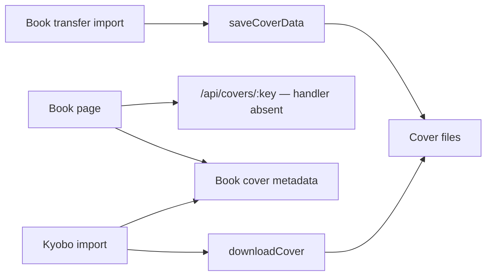

# Book cover plan review

[Dashboard](#dashboard) · [Module Dependency Graph](#module-dependency-graph) · [Top Findings](#top-findings) · [Recommendation](#recommendation)

**Revise before implementation.** The book page requests a cover URL with no handler in the working tree. A successful save can still produce a broken image.

## Dashboard

**Mode:** Health Dashboard  
**Scope:** Task 17 plan and the book-cover paths it references; static review only.  
**Composite Score:** 97/100  
**Trend:** 99 → 97; the previous review covered a different scope.

- Code quality: skipped; no implementation diff for this task.
- Architecture: 95/100. The planned read path lacks a handler.
- Tech debt: 100/100. No additional finding in the proposed fix.
- Test quality: 95/100. Only the live check requires an authenticated HTTP read.

## Module Dependency Graph

## Top Findings

**R5 — The book page depends on a missing route (Warning)**

- Symptom: `src/app/books/[id]/page.tsx:65` renders `/api/covers/${book.coverKey}`. There is no corresponding route, and `.gitignore:8` (`covers/`) also ignores the proposed route directory.
- Source: *The Mythical Man-Month* — Conceptual Integrity.
- Consequence: Fixing extraction or storage alone cannot make an already-saved cover visible through this URL.
- Remedy: Start with a book known to have a key and readable bytes. Request its URL as a library member. If the handler is missing, plan an access-checked reader and narrow the ignore rule so the route ships while stored images stay ignored. Then repeat the fresh Kyobo import to check for an independent write failure.

**T5 — The offline test can pass without serving a cover (Warning)**

- Symptom: Verification step 1 checks bytes and metadata; step 2 alone requires the real URL and depends on a live Kyobo import.
- Source: *How Google Tests Software* — Change Coverage.
- Consequence: A local file read can pass even when the URL is absent or fails to check library access.
- Remedy: Seed a book and known image offline. Request the actual URL as a member and assert image bytes and MIME type. Repeat as a signed-in nonmember and assert no image is returned.

## Recommendation

Separate “was the cover saved?” from “can the reader fetch it?” before changing the parser. Use a local transfer import with a known book cover as the upload-side control; `folderCoverInput` uploads belong to folders. Keep the live Kyobo case as the final source-specific check.
